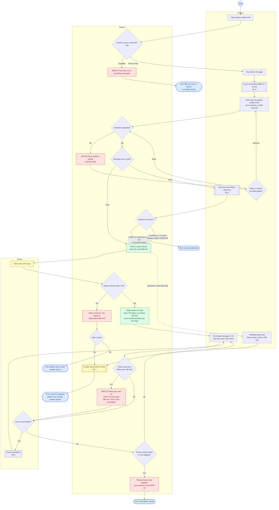
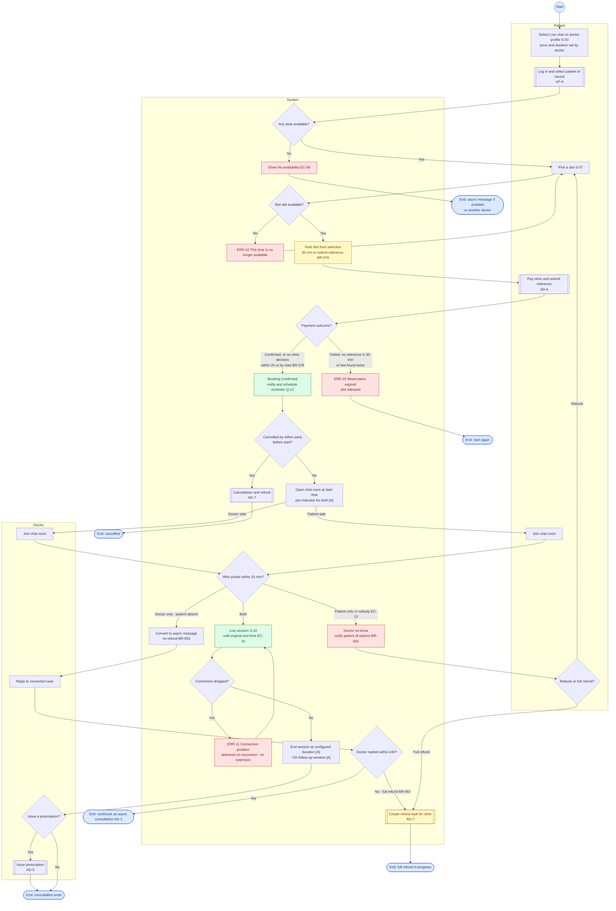
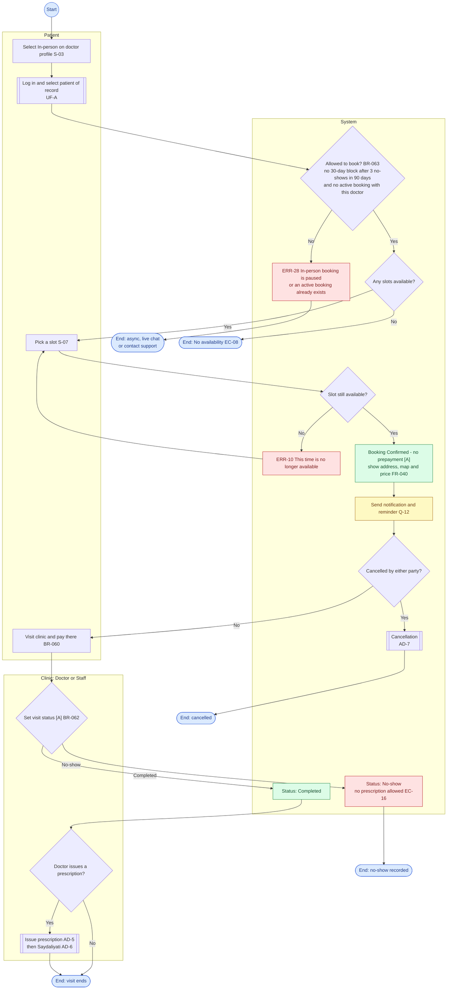
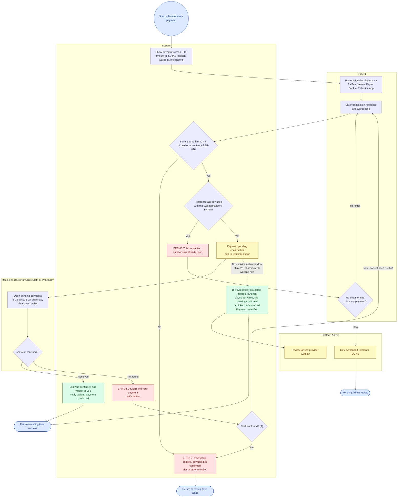
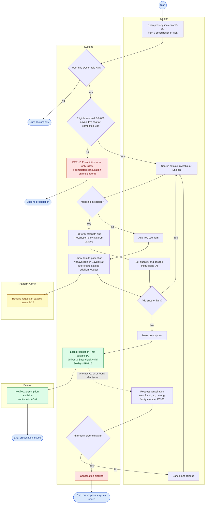
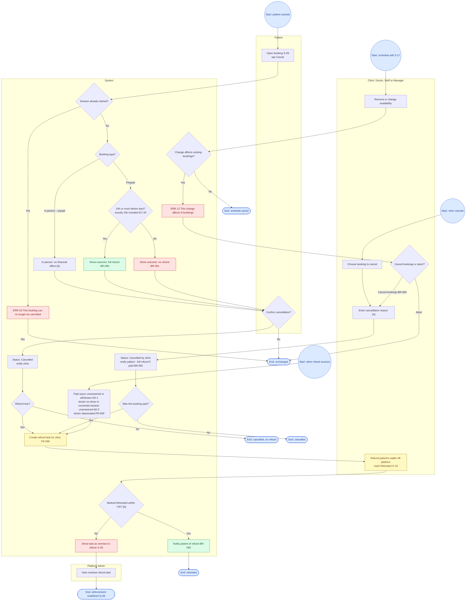
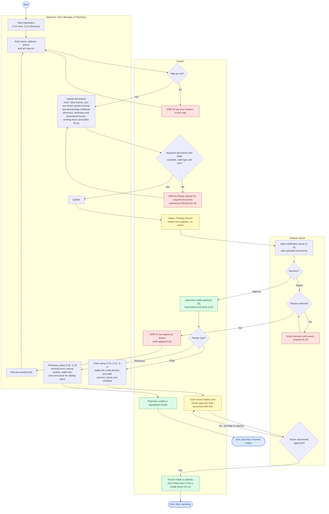
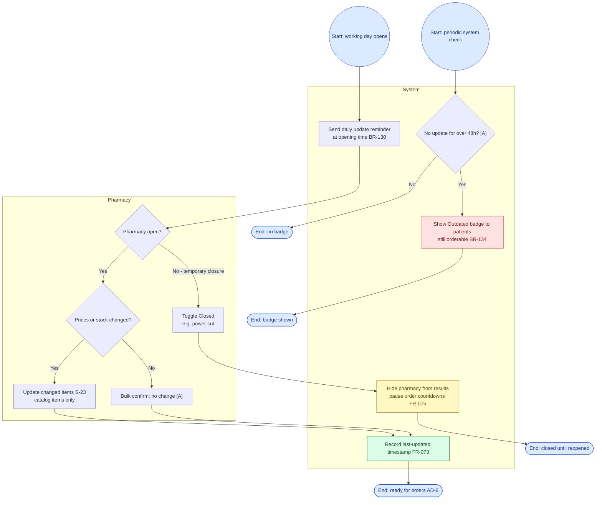

# مخططات النشاط (Activity Diagrams) — التِئام (Iltiam)

| الحقل | القيمة |
|---|---|
| الحالة | مسودة v1.0 |
| التاريخ | 2026-10-27 |
| المصادر | [PRD.md](../PRD.md) v1.2، [user-flow.md](../user-flow.md) |
| الصيغة | Mermaid `flowchart TD` مع مسارات (Swimlanes) عبر `subgraph` |
| النطاق | العمليات الرئيسية في الـ MVP فقط (PRD §9.1) |

تُظهر هذه المخططات **من يفعل ماذا** في كل عملية رئيسية: إجراءات كل طرف وإجراءات النظام في مسارات منفصلة، مع نقاط القرار، ومسارات النجاح والفشل والبدائل. لم تُضَف أي خطوة غير موجودة في الـ PRD أو في مخططات تدفق المستخدم. هذه ليست تصميم شاشات ولا كود.

## كيف تقرأ المخططات

| الرمز / اللون | المعنى |
|---|---|
| `(( Start ))` | نقطة البداية |
| `([ End: ... ])` أزرق | نقطة النهاية (مع نتيجتها) |
| `[ ... ]` | إجراء (Action) يقوم به الطرف أو النظام |
| `{ ... }` | نقطة قرار؛ كل فرع مكتوب عليه شرطه |
| `[[ ... ]]` | نشاط فرعي مرسوم في مخطط مستقل (مثل AD-4) |
| مستطيل بعنوان (Patient / System / ...) | مسار الطرف (Swimlane) |
| سهم متقطع `-.->` | مسار بديل اختياري يبدأه الطرف في أي وقت ضمن شرطه |
| أخضر | نجاح |
| أحمر | خطأ أو فشل |
| أصفر | انتظار / حالة معلّقة |
| `[A]` | خطوة مبنية على افتراض في الـ PRD |
| `Q-xx` | خطوة تعتمد على سؤال مفتوح |

### فهرس المخططات

| # | العملية | الأطراف | ميزات الـ PRD | مصدر التدفق |
|---|---|---|---|---|
| AD-1 | استشارة برسالة غير متزامنة | Patient، System، Doctor | F-05 | UF-1 |
| AD-2 | استشارة نصية مباشرة محجوزة (Should Have) | Patient، System، Doctor | F-06 | UF-2 |
| AD-3 | حجز موعد حضوري | Patient، System، Clinic | F-07 | UF-3 |
| AD-4 | التحقق اليدوي من الدفع (نشاط فرعي) | Patient، System، Recipient، Admin | F-09 | UF-B |
| AD-5 | إصدار وصفة إلكترونية | Doctor، System، Admin، Patient | F-10، F-11 | UF-C |
| AD-6 | صيدليتي: الطلب والدفع والاستلام | Patient، System، Pharmacy | F-12 – F-14 | UF-D |
| AD-7 | الإلغاء والاسترداد | Patient، Clinic، System، Admin | F-15 | UF-4 |
| AD-8 | تسجيل الشريك والتحقق منه (عيادة / صيدلية) | Applicant، System، Admin | F-01، F-02، F-18 | UF-5، UF-6 |
| AD-9 | التحديث اليومي لمخزون الصيدلية | Pharmacy، System | F-13 | UF-6 |

> تسجيل الدخول واختيار «المريض المعني» (UF-A) يظهر كنشاط فرعي داخل المخططات ولم يُرسم منفصلًا لأنه موجود في user-flow.md.

---

## AD-1 — استشارة برسالة غير متزامنة

### الشرح

1. **البداية:** المريض على صفحة الطبيب. النظام يفحص وضع الرسائل الذي اختاره الطبيب: مجاني، مدفوع، أو معطّل (BR-040). إذا كان معطّلًا يظهر ERR-07 ويُقترح الحجز المباشر أو الحضوري أو طبيب آخر.
2. **إعداد الحالة:** يسجّل المريض الدخول ويختار المريض المعني، ثم يكتب الحالة ويرفق الصور. إذا فشل رفع صورة تُحفظ محليًا، ويختار المريض **إعادة المحاولة** أو **حذف الصورة** (EC-12، ERR-08).
3. **الرسالة المجانية** تُسلَّم فورًا ويبدأ عدّاد 24 ساعة. **الرسالة المدفوعة** تمر بنشاط الدفع AD-4 أولًا:
   - **فشل الدفع** (لا مرجع خلال 30 دقيقة أو «غير موجود» مرتين) ← لا تُسلَّم الحالة.
   - **نجاح الدفع، أو عدم قرار العيادة خلال ساعتين** ← تُسلَّم الحالة (BR-078).
4. **بديل:** في الحالة المدفوعة فقط، يستطيع المريض **سحب** الحالة قبل أن يفتحها الطبيب، مع استرداد كامل (BR-049).
5. **لا رد خلال 24 ساعة:** الحالة «منتهية – بلا رد»، ويُبلَّغ المريض. إن كانت مدفوعة تُنشأ مهمة استرداد للعيادة (BR-043).
6. **بعد أول رد:** تُفتح نافذة متابعة 72 ساعة. للمريض **3 رسائل متابعة**، ثم يظهر ERR-25، والطبيب يستطيع الرد بلا حد (BR-048).
7. يستطيع الطبيب إصدار وصفة أثناء المحادثة (AD-5). تُغلق المحادثة عندما يغلقها الطبيب أو تنتهي 72 ساعة، ثم يُعطَّل الإدخال (EC-11، ERR-09).

**المراجع:** US-04، US-12، BR-040 – BR-049، BR-076، BR-078، FR-024 – FR-031، FR-030a، FR-030b، EC-09 – EC-12، EC-47، ERR-07 – ERR-09، ERR-25.

**أسئلة مفتوحة:** حد المتابعات (3) ومهلة العيادة (ساعتان) قواعد مفوَّضة [D] تحتاج تحققًا في التجربة الأولى. حدود الصور افتراض [A] (BR-047).

---

## AD-2 — استشارة نصية مباشرة محجوزة (Should Have)

> **Should Have (QR-17):** أول ميزة تُحذف إذا تأخر الجدول الزمني.

### الشرح

1. يختار المريض «محادثة مباشرة»؛ السعر والمدة يحددهما الطبيب (BR-051). إذا لا توجد مواعيد يظهر «لا توجد مواعيد» (EC-08).
2. يُحجز الموعد **لحظة اختياره**. إذا سبقه مريض آخر يظهر ERR-10 ويختار موعدًا آخر (EC-21).
3. **الدفع مسبق** لمحفظة العيادة عبر AD-4. أمام المريض 30 دقيقة لإدخال المرجع، وإلا يُلغى الحجز (ERR-15). إذا لم تقرر العيادة خلال ساعتين أو قبل البدء، يُؤكَّد الحجز ويُبلَّغ المسؤول (BR-078).
4. **الإلغاء قبل البدء** ينتقل إلى AD-7.
5. **عند البدء** يفحص النظام من حضر خلال 15 دقيقة:
   - **الاثنان:** الجلسة حتى وقت النهاية الأصلي. انقطاع الاتصال لا ينهيها ولا يمددها (EC-14، ERR-11).
   - **الطبيب فقط:** تتحول إلى رسالة غير متزامنة **دون استرداد** (BR-053). إذا لم يرد الطبيب خلال 24 ساعة ← استرداد كامل (BR-057).
   - **المريض فقط أو لا أحد:** غياب الطبيب؛ يختار المريض **إعادة الحجز** أو **استردادًا كاملًا** (BR-054، EC-13).
6. بعد انتهاء المدة تُطبَّق نافذة متابعة 72 ساعة [A]، ويمكن إصدار وصفة.

**المراجع:** US-05، BR-050 – BR-057، BR-076، BR-078، FR-032 – FR-038، EC-13 – EC-15، EC-21، EC-41، ERR-10، ERR-11، ERR-15.

**أسئلة مفتوحة:** Q-07 (هل يمكن أن تكون مجانية؟)، Q-12 (توقيت التذكير)، Q-18 (أقل مهلة قبل الحجز).

---

## AD-3 — حجز موعد حضوري

### الشرح

1. لا يمر أي دفع عبر المنصة؛ المريض يدفع في العيادة (BR-060).
2. **حماية من سوء الاستخدام:** حجز حضوري نشط واحد فقط لكل مريض معني مع نفس الطبيب، و3 غيابات خلال 90 يومًا تمنع الحجز الحضوري 30 يومًا. المسؤول يستطيع رفع المنع (BR-063، ERR-28).
3. يُؤكَّد الحجز فور اختيار الموعد [A]، ويُعرض العنوان والخريطة والسعر (FR-040).
4. بعد الزيارة يحدد الطبيب أو الموظف الحالة: **مكتمل** أو **غياب** [A]. **الوصفة ممكنة فقط للزيارة المكتملة** (FR-042، EC-16).

**المراجع:** US-06، BR-060 – BR-063، FR-039 – FR-042، AC-22، AC-23، AC-23a، EC-16، ERR-10، ERR-28.

**أسئلة مفتوحة:** Q-12، Q-18. حدود الغياب في BR-063 قواعد مفوَّضة [D].

---

## AD-4 — التحقق اليدوي من الدفع (نشاط فرعي مشترك)

يُستدعى من: الرسالة المدفوعة (AD-1)، المحادثة المباشرة (AD-2)، طلب الصيدلية (AD-6).

### الشرح

1. **المنصة لا تستلم أي مبلغ:** الدفع مباشر من محفظة المريض إلى محفظة العيادة أو الصيدلية (BR-070). لا يُستخدم رفع صورة الإيصال (BR-074).
2. يدفع المريض في تطبيق المحفظة، ثم يُدخل **رقم المرجع** والمحفظة المستخدمة (BR-072، FR-048).
3. **مهلة المريض:** 30 دقيقة من حجز الموعد أو قبول الصيدلية، وإلا يُلغى الحجز (BR-076، ERR-15).
4. **المرجع يُستخدم مرة واحدة لكل مزوّد محفظة** (BR-075، ERR-13). إذا كان المريض متأكدًا أنه مرجعه، يرسل بلاغًا «هذا دفعي» للمسؤول (EC-45).
5. **المستلم** يفحص محفظته ويختار «وصل» أو «غير موجود» (BR-073). عند «غير موجود» يُسمح للمريض **بتصحيح واحد** [A] ثم يُلغى الحجز (FR-051).
6. **مهلة المستلم:** العيادة ساعتان، والصيدلية 60 دقيقة عمل. إذا لم يقرر، **يُحمى المريض** وتُبلَّغ الإدارة (BR-078، FR-052).
7. كل تأكيد يُسجَّل: من أكّد ومتى (FR-053).

**المراجع:** US-07، US-16، BR-070 – BR-078، FR-047 – FR-053، AC-26 – AC-29، AC-29a، AC-29b، EC-18 – EC-21، EC-45، ERR-13 – ERR-15.

**أسئلة مفتوحة:** Q-08 (النزاع: المريض يقول دفع والمستلم يقول لا، أو مبلغ خاطئ — لا يوجد مسار بعد التصحيح الواحد). مدد المهلات قواعد مفوَّضة [D]. عملة الشيكل افتراض [A].

---

## AD-5 — إصدار وصفة إلكترونية

### الشرح

1. الوصفة للطبيب فقط [A] (BR-083)، وفقط **بعد خدمة تمت على المنصة**: رسالة، محادثة مباشرة، أو زيارة مكتملة (BR-080، ERR-16).
2. الأصناف من **الكتالوج الموحّد** بالبحث بالعربية أو الإنجليزية (BR-081). الشكل والتركيز وعلامة «بوصفة فقط» تأتي من الكتالوج.
3. إذا لم يوجد الدواء: يضيفه الطبيب **نصًا حرًا**، يظهر للمريض «غير متوفر في صيدليتي»، ويُرسل **طلب إضافة للكتالوج** للمسؤول تلقائيًا (BR-082، FR-056).
4. بعد الإصدار تصل الوصفة إلى صيدليتي ويُبلَّغ المريض. **صالحة 30 يومًا**، وكل صنف يُصرف **مرة واحدة** (BR-126، BR-127).
5. لا تُعدَّل بعد الإصدار [A]. تُلغى ويُعاد إصدارها **فقط إذا لا يوجد طلب صيدلية** (BR-085، FR-059، EC-23).

**المراجع:** US-13، US-14، BR-080 – BR-089، BR-126 – BR-128، FR-054 – FR-063، AC-30 – AC-32، EC-22 – EC-24، ERR-16.

**أسئلة مفتوحة:** Q-14 / Q-19 (صلاحية 30 يومًا، الصرف مرة واحدة، أصناف «بوصفة فقط» — تحتاج تأكيدًا قانونيًا). عدم التعديل بعد الإصدار افتراض [A].

---

## AD-6 — صيدليتي: الطلب والدفع والاستلام

```mermaid
flowchart TD
    START(("Start: prescription issued notification"))

    subgraph PAT["Patient"]
        direction TB
        P1["Open Saydaliyati S-11<br/>select prescription"]
        P2["Allow location access"]
        P3["Choose area from list"]
        P4{"Change area or retry later?"}
        P5["Pick one pharmacy<br/>pickup window shown FR-069"]
        P6{"How to proceed?"}
        P7["Send order"]
        P8{"Accept confirmed price? [A]"}
        P9[["Pay pharmacy and submit reference<br/>AD-4"]]
        P10["Patient or relative shows code<br/>at the pharmacy BR-096"]
    end

    subgraph SYS["System"]
        direction TB
        S1{"Prescription within 30 days? BR-126"}
        S2["ERR-27 This prescription has expired<br/>pending items marked Expired"]
        S3{"All items free-text?"}
        S4["Show prescription only<br/>all items Not available in Saydaliyati EC-22"]
        S5{"GPS successful?"}
        S6["ERR-19 Couldn't get your location"]
        S7["Show pharmacy results S-12<br/>open and visible only, full availability first<br/>then distance, price, last updated, outdated badge [A]"]
        S8{"Any open pharmacy<br/>has any item?"}
        S9{"Matching pharmacies exist<br/>but all closed now? FR-070"}
        S10["ERR-26 Pharmacies with these medicines<br/>are closed now - first opening time"]
        S11["ERR-18 No nearby pharmacy currently<br/>has these medicines"]
        S12{"One pharmacy has all items?"}
        S13["Send order to pharmacy<br/>lock items BR-127<br/>start 30 working-min countdown"]
        S14["ERR-21 Pharmacy didn't respond in time<br/>order auto-cancelled"]
        S15["ERR-20 The pharmacy couldn't fulfil your order"]
        S16["Items return to Pending<br/>other sub-orders continue EC-28"]
        S17{"Payment outcome?"}
        S18["Order released EC-32"]
        S19["Issue pickup code: numeric and QR<br/>available offline S-13<br/>marked Payment unverified if not confirmed"]
        S20["Daily reminder until pickup or expiry BR-098"]
        S21{"Code presented within<br/>pickup window?"}
        S22["Status: Expired<br/>payment outcome Q-04"]
        S23{"Code valid for this pharmacy?"}
        S24["ERR-22 Code not valid for this pharmacy"]
        S25{"Payment unverified?"}
        S26{"Order has a<br/>Prescription-only item?"}
        S27["Status: Delivered<br/>items dispensed, cannot be reordered BR-127"]
    end

    subgraph PHA["Pharmacy"]
        direction TB
        H1["Review order S-24<br/>items only, no diagnosis FR-077"]
        H2{"Accept or reject?"}
        H3["Enter or scan pickup code"]
        H4["Check wallet at the counter BR-078"]
        H5["Record collector's name<br/>check patient of record BR-128"]
    end

    E1(["End: start a new consultation"])
    E2(["End: nothing to order"])
    E3(["End: prescription stays pending"])
    E4(["End: order expired"])
    E5(["End: medicine in patient's or relative's hands"])

    START --> P1 --> S1
    S1 -->|"No"| S2 --> E1
    S1 -->|"Yes"| S3
    S3 -->|"Yes"| S4 --> E2
    S3 -->|"No"| P2 --> S5
    S5 -->|"No"| S6 --> P3 --> S7
    S5 -->|"Yes"| S7
    S7 --> S8
    S8 -->|"No"| S9
    S9 -->|"Yes"| S10 --> E3
    S9 -->|"No"| S11 --> P4
    P4 -->|"Change area"| P3
    P4 -->|"Later"| E3
    S8 -->|"Yes"| S12
    S12 -->|"Yes"| P5 --> P7
    S12 -->|"No"| P6
    P6 -->|"Split: one sub-order per pharmacy<br/>Should Have"| P7
    P6 -->|"Buy available items<br/>rest stays Pending"| P7
    P7 --> S13 --> H1 --> H2
    S13 -.->|"No response within 30 working min<br/>paused while Closed EC-39"| S14
    S14 --> S16
    H2 -->|"Reject with reason [A]<br/>incl. partial stock"| S15 --> S16
    S16 --> S7
    H2 -->|"Accept"| P8
    P8 -->|"No"| S16
    P8 -->|"Yes"| P9 --> S17
    S17 -->|"Failed: no reference in 30 min<br/>or Not found twice"| S18 --> S16
    S17 -->|"Confirmed, or no pharmacy decision<br/>within 60 working min BR-078"| S19 --> S20 --> S21
    S21 -->|"No"| S22 --> E4
    S21 -->|"Yes"| P10 --> H3 --> S23
    S23 -->|"No"| S24 --> H3
    S23 -->|"Yes"| S25
    S25 -->|"Yes"| H4 --> S26
    S25 -->|"No"| S26
    S26 -->|"Yes"| H5 --> S27
    S26 -->|"No"| S27
    S27 --> E5

    classDef term fill:#dbeafe,stroke:#1d4ed8,color:#1e3a8a
    classDef ok fill:#dcfce7,stroke:#15803d,color:#14532d
    classDef fail fill:#fee2e2,stroke:#b91c1c,color:#7f1d1d
    classDef wait fill:#fef9c3,stroke:#a16207,color:#713f12
    class START,E1,E2,E3,E4,E5 term
    class S19,S27 ok
    class S2,S6,S10,S11,S14,S15,S18,S22,S24 fail
    class S13,S16,S20,H1 wait
```

### الشرح

1. **الصلاحية:** الوصفة صالحة 30 يومًا؛ بعدها لا تُطلب أصنافها المعلّقة (BR-126، ERR-27). الأصناف النصية الحرة لا تُطابَق مع الصيدليات أبدًا (BR-125).
2. **الموقع:** GPS أولًا؛ إذا فشل أو رُفض، يختار المريض منطقة من قائمة (BR-120، ERR-19).
3. **النتائج:** الصيدليات المفتوحة وغير المخفية فقط، الأكمل توفرًا أولًا ثم الأقرب، مع السعر و«آخر تحديث»، وشارة «قديم» بعد 48 ساعة [A] (BR-121 – BR-124، BR-134).
4. **لا يوجد توفر:** ERR-18 مع تغيير المنطقة أو المحاولة لاحقًا. إذا الصيدليات المطابقة كلها مغلقة الآن: ERR-26 مع أول وقت فتح (FR-070، EC-40).
5. **توفر جزئي:** شراء المتوفر وترك الباقي معلّقًا حتى انتهاء الوصفة (Must Have، BR-123)، أو التقسيم على أكثر من صيدلية (Should Have، FR-067).
6. **الصيدلية** ترى الأصناف فقط دون تشخيص، وتقبل أو ترفض خلال **30 دقيقة عمل**، وإلا يُلغى الطلب تلقائيًا. الوقت أثناء «مغلق» لا يُحسب (BR-131، EC-39). لا يوجد قبول جزئي (BR-133).
7. عند الرفض أو الإلغاء التلقائي أو رفض السعر أو فشل الدفع: ترجع الأصناف «معلّقة» ويعود المريض للنتائج (EC-28، EC-30، EC-32).
8. **الدفع بعد القبول فقط** بالسعر المقبول (BR-132)، عبر AD-4.
9. **كود الاستلام** (رقم + QR) يعمل دون إنترنت، و**أي شخص يحمل الكود يستلم** (BR-095، BR-096). تذكير يومي حتى الاستلام أو الانتهاء (BR-098).
10. **عند الاستلام:** كود صيدلية أخرى ← ERR-22. الدفع غير المؤكد ← فحص المحفظة عند الكاونتر. صنف «بوصفة فقط» ← تسجيل اسم المستلم (BR-128). ثم «تم التسليم» ولا يُطلب الصنف مجددًا (BR-127).
11. انتهاء نافذة الاستلام ← «منتهي» (FR-083)، ومصير المبلغ سؤال مفتوح (Q-04).

**المراجع:** US-09 – US-11، US-19 – US-21، BR-076، BR-078، BR-095 – BR-099، BR-120 – BR-134، FR-064 – FR-083، AC-35 – AC-47، EC-22، EC-25 – EC-34، EC-39، EC-40، EC-43، ERR-18 – ERR-22، ERR-26، ERR-27.

**أسئلة مفتوحة:** Q-04 (استرداد الطلب غير المستلم)، Q-09 (نفاد المخزون بعد القبول والدفع — غير مرسوم لأنه غير معرَّف)، Q-14 / Q-19.

---

## AD-7 — الإلغاء والاسترداد

### الشرح

**إلغاء المريض:**
1. بعد بدء الجلسة لا يمكن الإلغاء (ERR-23).
2. **الحضوري** غير مدفوع مسبقًا، فيُلغى دون أثر مالي [A] (BR-094).
3. **المدفوع مسبقًا:** قبل 24 ساعة أو أكثر ← استرداد كامل (BR-090)؛ أقل من 24 ساعة ← لا استرداد (BR-091). **النتيجة تظهر قبل التأكيد** (FR-084).

**إلغاء العيادة:**
4. العيادة تلغي مع سبب [A]، و**الاسترداد كامل دائمًا** للمدفوع (BR-092).
5. حذف مواعيد عليها حجوزات يتطلب إلغاءها، ويُحسب إلغاءً من العيادة (BR-068، ERR-12).

**تنفيذ الاسترداد:**
6. تُنشأ **مهمة استرداد** للعيادة. مصادرها الأخرى: رسالة مدفوعة بلا رد أو مسحوبة، غياب الطبيب، جلسة محوّلة بلا رد، تعطيل الطبيب.
7. العيادة تعيد المبلغ لمحفظة المريض **خارج المنصة** وتضع «تم الاسترداد»، ويُبلَّغ المريض (BR-093).
8. المهام المتأخرة أكثر من 72 ساعة [A] تظهر للمسؤول (FR-087). ما يفعله المسؤول بعدها غير معرَّف (Q-08).

**المراجع:** US-08، BR-043، BR-049، BR-054، BR-057، BR-068، BR-090 – BR-094، FR-009، FR-084 – FR-087، AC-48 – AC-50، EC-35، EC-36، ERR-12، ERR-23.

**أسئلة مفتوحة:** Q-08 (تطبيق الاسترداد ودور المسؤول في النزاعات). حد 72 ساعة افتراض [A].

---

## AD-8 — تسجيل الشريك والتحقق منه (عيادة / صيدلية)

### الشرح

1. **التسجيل ذاتي** للعيادة والصيدلية: الاسم والعنوان والهاتف ودبوس الخريطة والمستندات (BR-003، BR-010، FR-001، FR-012).
   - العيادة: ترخيص العيادة، ولكل طبيب ترخيص مزاولة وشهادة تخصص جلدية. لا يوجد طبيب دون عيادة فعلية (BR-001)، والعيادة الخاصة = عيادة بطبيب واحد (BR-002).
   - الصيدلية: ترخيص الصيدلية والصيدلي [A]، و**ساعات العمل ومحفظة واحدة على الأقل إلزامية** [A] (BR-011 – BR-013، AC-06).
2. نقص مستند يمنع الإرسال (ERR-01)، وكذلك غياب دبوس الخريطة (ERR-03).
3. بعد الإرسال الحالة **قيد المراجعة**: مخفي عن المرضى ولا يستقبل طلبات (BR-004، FR-003).
4. **المسؤول** يوافق أو يرفض، و**سبب الرفض إلزامي** (FR-004، AC-03). المرفوض يعدّل ويعيد الإرسال [A] (BR-007).
5. **بعد الموافقة:**
   - العيادة: المحافظ، دعوة الأطباء والموظفين، الخدمات والأسعار، الجدول (FR-007، BR-065). **كل طبيب مخفي حتى يوافق المسؤول على مستنداته** (BR-005)، والعيادة بلا طبيب ظاهر لا تُعرض (EC-01 [A]).
   - الصيدلية: ساعات العمل ونافذة الاستلام والمحافظ، ثم الأسعار والمخزون **لأصناف الكتالوج فقط** (BR-089، BR-097).
6. تبدأ الفترة التجريبية للاشتراك بعد الموافقة؛ دورة الاشتراك (نشط ← مهلة 7 أيام ← مخفي) موجودة في UF-5 ولم تُرسم هنا لأنها Should Have (F-17).

**المراجع:** US-17، US-18، US-22، BR-001 – BR-013، BR-065، BR-089، BR-097، FR-001 – FR-013، AC-01 – AC-06، EC-01 – EC-04، ERR-01 – ERR-03.

**أسئلة مفتوحة:** Q-02 / Q-05 / Q-06 (بداية الفترة التجريبية ومدتها والأسعار). قائمة مستندات الصيدلية (BR-011) افتراض [A].

---

## AD-9 — التحديث اليومي لمخزون الصيدلية

### الشرح

1. عند وقت الفتح يرسل النظام **تذكير تحديث يومي** (BR-130).
2. الصيدلية تحدّث الأصناف التي تغيّرت، أو تؤكد «لا تغيير» بضغطة واحدة [A] (FR-072). كل تحديث يُسجَّل بوقته ويظهر للمرضى (FR-073).
3. تستطيع الصيدلية تفعيل **«مغلق»** مؤقتًا: تختفي من النتائج وتتوقف عدّادات الطلبات (FR-013 [A]، FR-075، EC-39).
4. بدون تحديث لأكثر من 48 ساعة تظهر شارة **«قديم»**، ويبقى الطلب ممكنًا [A] (BR-134).

**المراجع:** US-19، BR-089، BR-130، BR-134، FR-013، FR-071 – FR-073، FR-075، AC-07، AC-41a، EC-05، EC-39.

**أسئلة مفتوحة:** Q-16 (هل تحتاج الصيدلية أكثر من حساب موظف؟).

---

## خارج هذا المستند

- **التنقل حسب الدور، التسجيل وتسجيل الدخول، لوحة المسؤول، دورة الاشتراك:** موجودة في [user-flow.md](../user-flow.md) (UF-0، UF-A، UF-7، UF-5).
- **مسارات غير معرَّفة في الـ PRD لم تُرسم عمدًا:** نزاعات الدفع (Q-08)، نفاد المخزون بعد الدفع (Q-09)، مصير مبلغ الطلب المنتهي (Q-04)، إجراءات المسؤول على الاسترداد المتأخر (Q-08).
