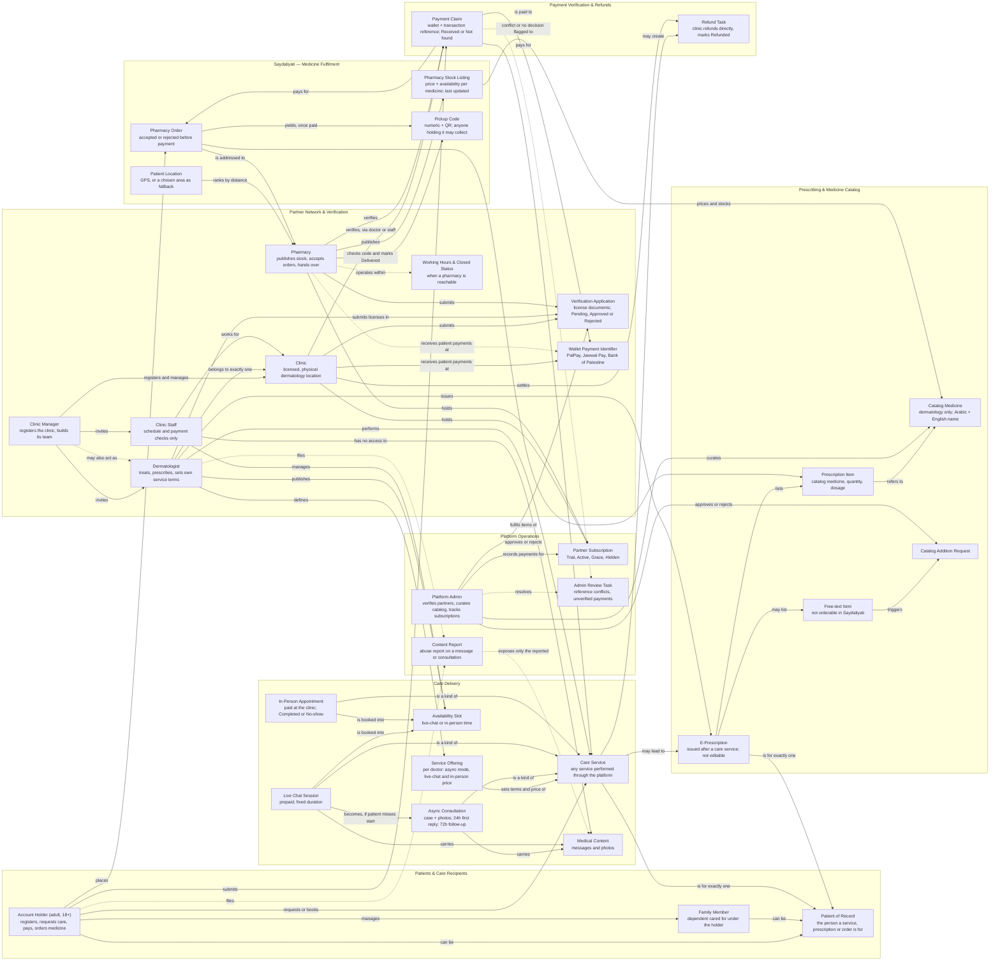

# Conceptual Domain Model — Iltiam (التِئام)

| Field | Value |
|---|---|
| Status | Draft v1.0 |
| Date | 2026-10-27 |
| Sources | [PRD.md](../PRD.md) v1.1, [user-flow.md](../user-flow.md) |
| Diagram source | [domain-model.mmd](domain-model.mmd) |

This is a **business** view of the product. It shows the main concepts, what each one is responsible for, which business area it belongs to, and how the concepts relate. It is not a database design, class diagram or API contract.

## How to read the diagram

- **Boxes (subgraphs)** are the business areas (boundaries).
- **Nodes** are the business concepts. The second line of each node states its responsibility.
- **Solid arrow**: relationship confirmed by the product owner (PRD tag [C]).
- **Dashed arrow**: relationship that comes from an assumption [A] or a delegated decision [D]. It may change.
- Cardinality ("exactly one", "one or more") appears only where the PRD confirms it.

## Diagram

## Business areas (boundaries)

| Area | Owns | Does not own |
|---|---|---|
| Patients & Care Recipients | Who receives care and who acts for them | Medical content; payments |
| Partner Network & Verification | Clinics, doctors, staff, pharmacies, and their approval | Subscription status (Platform Operations) |
| Care Delivery | The three consultation types, their terms, slots, and medical content | Prescriptions; money |
| Prescribing & Medicine Catalog | Prescriptions and the single dermatology medicine list | Prices and stock (Saydaliyati) |
| Saydaliyati — Medicine Fulfilment | Matching pharmacies, orders, pickup | Which medicines exist (Catalog) |
| Payment Verification & Refunds | Proof that a patient paid outside the platform; refund obligations | The money itself: it never passes through the platform (BR-070) |
| Platform Operations | Subscriptions, catalog curation, abuse reports, exception handling | General access to medical content (FR-099) |

## Concepts and sources

| Concept | Responsibility | Source |
|---|---|---|
| Account Holder | Adult (18+) who registers, requests care for self or family, pays, and orders medicine. | BR-020 – BR-022 [C] |
| Family Member | Dependent (for example a child) managed under one account holder. | BR-022, FR-017 [C] |
| Patient of Record | The specific person a consultation, booking, prescription or order is for. | BR-023, FR-018 [C] |
| Clinic Manager | Registers the clinic and invites doctors and staff. May also hold the Doctor role. | FR-001, FR-007 [C]; BR-008 [D] |
| Clinic | Licensed physical location. A private clinic is a clinic with one doctor. | BR-001 – BR-004 [C] |
| Dermatologist | Belongs to exactly one clinic; sets service terms; performs services; issues prescriptions. | BR-001, BR-040, BR-051 [C] |
| Clinic Staff | Manages the schedule and confirms payments. Never sees medical content. | BR-065, BR-073, FR-031 [C] |
| Pharmacy | Publishes price and availability, accepts or rejects orders, hands over against a pickup code. | BR-010, BR-089, BR-131 [C] |
| Verification Application | Licence documents reviewed by the Admin before a partner is visible. | BR-003 – BR-005, BR-010 [C] |
| Wallet Payment Identifier | Where patients send money. Clinic wallet [C] (BR-050); pharmacy identifiers [A] (BR-013). | BR-050, BR-013 |
| Working Hours & Closed Status | Defines when a pharmacy is shown and when its timers count. | BR-012 [A], FR-013 [A] |
| Service Offering | A doctor's terms: async Free / Paid / Disabled, live-chat price and duration, in-person price. | BR-031, BR-040, BR-051 [C] |
| Availability Slot | A bookable time, typed as live chat or in-person. | BR-065 [C], BR-066 [A] |
| Care Service | Any service performed through the platform. It is the only basis for a prescription. | BR-080 [C] |
| Async Consultation | Case with photos; 24h first-reply deadline; 72h follow-up window. | BR-041 – BR-046 [C] |
| Live Chat Session | Prepaid, scheduled real-time chat. Becomes async if the patient doesn't join in 15 minutes. | BR-050 – BR-053 [C] |
| In-Person Appointment | Clinic visit paid at the clinic. Prescribing only after it is Completed. | BR-060 [C], FR-042 |
| Medical Content | Messages and photos. Visible to the patient and the treating doctor only. | UN-12, FR-031 [C]; FR-100 [D] |
| E-Prescription | Issued by a doctor after a care service. Cannot be edited. | BR-080, BR-081 [C]; BR-085 [A] |
| Prescription Item | Catalog medicine with quantity and dosage. Dispensed once. | BR-084 [A], BR-127 [D] |
| Free-text Item | Medicine outside the catalog; never matched to pharmacies. | BR-082, BR-125 [C] |
| Catalog Medicine | Unified dermatology medicine, Arabic and English name, managed by Admin only. | BR-086 – BR-088 [C] |
| Catalog Addition Request | Created from a free-text item; approved or rejected by the Admin. | BR-082, FR-061 [C] |
| Patient Location | GPS, or a chosen area when GPS fails; used to rank pharmacies by distance. | BR-120, BR-121 [C] |
| Pharmacy Stock Listing | One pharmacy's price and availability for one catalog medicine, with "last updated". | BR-089, BR-122 [C] |
| Pharmacy Order | Request to one pharmacy for some prescription items. Patient pays only after acceptance. | BR-123, BR-131, BR-132 [C] |
| Pickup Code | Numeric + QR code issued after payment. Anyone holding it may collect. | BR-095, BR-096 [C] |
| Payment Claim | The wallet and transaction reference a patient enters; marked Received or Not found. | BR-072, BR-073 [C] |
| Refund Task | Obligation on the clinic to refund directly and mark it Refunded. | BR-090 – BR-093, BR-043 [C] |
| Partner Subscription | Trial, then monthly; Grace, then Hidden from new patients. | BR-111, BR-113, FR-091 [C] |
| Content Report | Abuse report that exposes only the reported messages to a Report Reviewer. | FR-100 [D] |
| Admin Review Task | Exceptions sent to the Admin: reference conflicts, providers who did not decide in time. | BR-075, BR-078 [D] |

Notifications and audit records are cross-cutting. They touch almost every concept, so the diagram leaves them out to stay readable (F-16, NFR-011).

## Open questions for the model

| # | Question | Why it matters to the model | PRD ref |
|---|---|---|---|
| DM-1 | Is the wallet owned by the clinic, or can each doctor receive payments in their own wallet? | Decides whether Wallet links to Clinic only, or to Doctor too. | BR-050, FR-047 |
| DM-2 | Is a subscription per clinic, or per doctor inside a clinic? | Decides who holds a Partner Subscription. | Q-06 |
| DM-3 | Does a pharmacy have one account, or several staff users? | May add a "Pharmacy Staff" concept. | Q-16 |
| DM-4 | Can one pharmacy order cover items from more than one prescription? | Changes the Order ↔ Prescription relationship. | Not covered |
| DM-5 | When a paid pharmacy order expires or the pharmacy finds a stock-out after payment, does the pharmacy owe a refund? | Today Refund Task is linked to clinics only. | Q-04, Q-09 |
| DM-6 | What does the Admin do when a clinic or pharmacy refuses to refund, or a payment is disputed? | May add a "Dispute" concept. | Q-08 |
| DM-7 | Can live chat ever be free? | Decides whether every Live Chat Session needs a Payment Claim. | Q-07 |
| DM-8 | Are pharmacies linked to the predefined areas, or only located by map pin? | Decides whether "Area" is its own concept. | BR-120 |
| DM-9 | Is the Admin one role, or several permissions (verification, catalog, Report Reviewer)? | May split Platform Admin into roles. | FR-100 |
| DM-10 | What are the legal rules for e-prescriptions, prescription-only medicines and who may see medical content? | Dashed links (Content Report, prescription validity) may change. | Q-10, Q-14 |
| DM-11 | How long is medical history kept after a family member is removed? | Affects the lifecycle of Family Member and Medical Content. | Q-11 |
