# مخططات تدفّق المستخدم (User Flows) — التِئام (Iltiam)

| الحقل | القيمة |
|---|---|
| المصدر | [PRD.md](PRD.md) — المسودة v1.0 (2026-10-15) |
| التاريخ | 2026-10-22 |
| النطاق | رحلات الـ MVP المؤكَّدة فقط (PRD §9.1 و§13) |
| الصيغة | Mermaid `flowchart TD` |
| النسخة الإنجليزية | [user-flow.md](user-flow.md) |

## كيف تقرأ هذا المستند

- كل مخطط يغطي رحلة واحدة، ويليه **شرح بالعربية** ثم **متطلبات PRD المرتبطة** ثم **أسئلة مفتوحة** خاصة به.
- لم تُضَف أي قاعدة عمل غير موجودة في الـ PRD. الخطوات المبنية على **افتراض [A]** في الـ PRD موسومة بـ `[A]` داخل المخطط، والخطوات المتوقفة على **سؤال مفتوح** موسومة برقم السؤال (مثل `Q-03`).
- أرقام الشاشات (`S-xx`) وحالات الخطأ (`ERR-xx`) والحالات الطرفية (`EC-xx`) مأخوذة كما هي من الـ PRD.

### دليل الألوان والأشكال

| الشكل / اللون | المعنى |
|---|---|
| `([ ... ])` أزرق | نقطة دخول أو خروج |
| `[ ... ]` | إجراء المستخدم أو استجابة النظام |
| `{ ... }` | نقطة قرار |
| `[[ ... ]]` | تدفّق فرعي مشترك (موضَّح في مخطط مستقل) |
| أخضر | مسار نجاح |
| أحمر | حالة خطأ أو مسار فشل |
| أصفر | حالة انتظار أو تعليق |

### فهرس التدفقات

| # | التدفّق | الأدوار | ميزات PRD |
|---|---|---|---|
| UF-0 | التنقّل حسب الدور | الجميع | §14، §15 |
| UF-A | التسجيل والدخول وأفراد العائلة | زائر، مريض | F-03، F-04 |
| UF-1 | الاستشارة بالرسائل غير المتزامنة | مريض، طبيب | F-05 |
| UF-2 | الاستشارة النصية المباشرة المحجوزة | مريض، طبيب | F-06 |
| UF-3 | حجز الزيارة الحضورية | مريض، طبيب، طاقم العيادة | F-07 |
| UF-B | التحقق اليدوي من الدفع (تدفّق فرعي) | مريض، طبيب/طاقم، صيدلية | F-09 |
| UF-C | إصدار الوصفة الإلكترونية | طبيب | F-10، F-11 |
| UF-D | صيدليتي: الطلب والاستلام | مريض، صيدلية | F-12، F-13، F-14 |
| UF-4 | الإلغاء والاسترداد | مريض، عيادة، مشرف | F-15، F-08 |
| UF-5 | تسجيل العيادة والطبيب والاشتراك | مدير العيادة، طبيب، طاقم، مشرف | F-01، F-08، F-17 |
| UF-6 | تسجيل الصيدلية وتشغيلها اليومي | صيدلية، مشرف | F-02، F-13 |
| UF-7 | لوحة المشرف | مشرف المنصة | F-11، F-17، F-18 |

---

## UF-0 — التنقّل حسب الدور

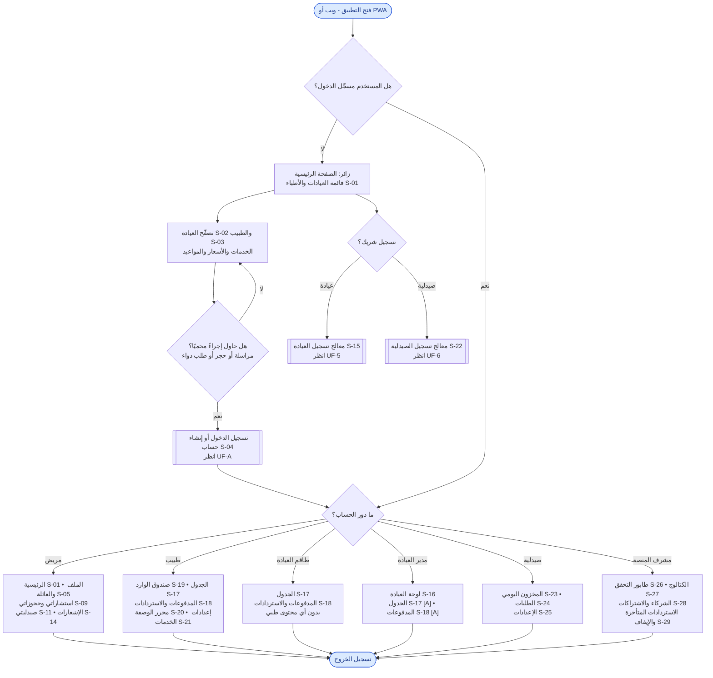

### الشرح

- **الزائر** يتصفّح العيادات والأطباء المعتمَدين والخدمات والأسعار دون حساب (BR-020). عند أي إجراء محمي يُطلب منه الدخول أو التسجيل، ثم يعود إلى نفس الإجراء (FR-023).
- يمكن للزائر أيضًا بدء **تسجيل شريك** (عيادة أو صيدلية) عبر معالج التسجيل الخاص.
- بعد الدخول يُوجَّه كل مستخدم إلى الشاشات التي يسمح بها دوره حسب مصفوفة الصلاحيات (§15):
  - **طاقم العيادة** يرى الجدول والمدفوعات فقط، **ولا يرى أي محتوى طبي** (SEC-03، FR-031).
  - **المشرف** لا يصل إلى المحتوى الطبي في الـ MVP (FR-099 [A]).
  - وصول **مدير العيادة** إلى الجدول وتأكيد المدفوعات افتراض [A].
- الإشعارات (S-14) متاحة لكل الأدوار المسجّلة.

### متطلبات PRD المرتبطة
BR-020، FR-020، FR-023، §14 (S-01 – S-29)، §15، SEC-01، SEC-03، FR-031، FR-099.

### أسئلة مفتوحة
- **Q-15:** هل يمكن أن يكون مدير العيادة طبيبًا في نفس الحساب؟ إن كان كذلك، يلزم مسار تبديل أو دمج بين القائمتين.
- **Q-16:** هل للصيدلية أكثر من حساب موظف؟ (يؤثر على قائمة الصيدلية).
- **Q-10:** هل يصل المشرف إلى المحتوى الطبي لحل النزاعات؟

---

## UF-A — التسجيل والدخول وأفراد العائلة

### الشرح

1. يصل الزائر إلى هذا التدفّق عند محاولة مراسلة طبيب أو حجز موعد أو طلب دواء، أو بفتح شاشة الدخول مباشرة.
2. **التسجيل** يكون بالبريد الإلكتروني وكلمة المرور فقط (BR-021). يجب تأكيد أن صاحب الحساب **بالغ (18+)**، وإلا لا يُنشأ الحساب (AC-10). القاصر لا يستخدم المنصة منفردًا، بل يُضاف كفرد عائلة (EC-06).
3. إذا كان البريد مسجّلًا يظهر ERR-04 ويُحوَّل المستخدم للدخول أو استعادة كلمة المرور.
4. بعد الدخول يعود المستخدم **إلى نفس الإجراء** الذي بدأه (FR-023، AC-08).
5. قبل أول خدمة مدفوعة أو محجوزة يُشترط التحقق من البريد (BR-024 — افتراض [A]).
6. لكل استشارة أو حجز أو طلب يجب اختيار **المريض المعني** (صاحب الحساب أو أحد أفراد العائلة) (BR-023، FR-018، AC-09)، ويمكن إضافة فرد جديد أثناء التدفّق.

### متطلبات PRD المرتبطة
US-02، US-03، BR-020 – BR-025، FR-014 – FR-019، FR-023، AC-08 – AC-10، EC-06، EC-07، ERR-04، ERR-05.

### أسئلة مفتوحة
- التحقق من البريد قبل أول خدمة (BR-024) وجمع رقم الجوال (BR-025) افتراضان يحتاجان تأكيدًا (§26.3).
- PRD لا يحدد ما يحدث عند خطأ الدخول المتكرر سوى "تقييد المحاولات" (SEC-07)؛ رسالة القفل وتوقيته غير محدَّدين.

---

## UF-1 — الاستشارة بالرسائل غير المتزامنة

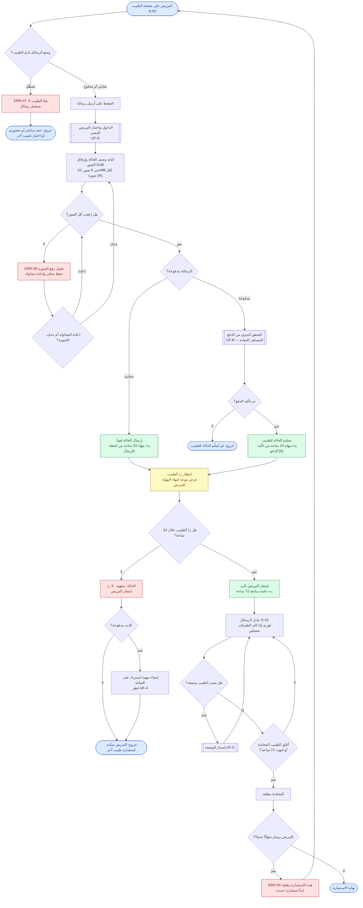

### الشرح

1. **نقطة البداية:** صفحة الطبيب. يحدد الطبيب وضع الرسائل: مجاني (افتراضي)، أو مدفوع بسعره، أو معطّل (BR-040). إذا كان معطّلًا يُقترح على المريض حجز استشارة مباشرة أو حضورية أو طبيب آخر (ERR-07).
2. يدخل المريض (أو يسجّل) ويختار **المريض المعني**، ثم يكتب الحالة ويرفق الصور (BR-046). حدود الصور افتراض [A] (BR-047). إذا فشل رفع صورة تُحفظ محليًا ويُعاد المحاولة، ولا تُرسَل الرسالة حتى تكتمل الصور أو تُحذف الفاشلة (EC-12).
3. **الرسالة المجانية** تُرسل فورًا وتبدأ مهلة 24 ساعة. **الرسالة المدفوعة** تمرّ بتدفّق الدفع اليدوي (UF-B) أولًا، وتبدأ المهلة من تأكيد الدفع (BR-042 [A]).
4. **إذا لم يردّ الطبيب خلال 24 ساعة:** تصبح الحالة "منتهية - لا رد"، يُشعَر المريض ويمكنه استشارة طبيب آخر، وإذا كانت مدفوعة تُنشأ مهمة استرداد على العيادة (BR-043، FR-029).
5. **بعد أول رد:** تبقى المحادثة مفتوحة 72 ساعة للمتابعة، ويمكن للطبيب إغلاقها مبكرًا (BR-044). الرسائل فورية إن كان الطرفان متصلين (BR-045).
6. يمكن للطبيب إصدار وصفة أثناء الاستشارة (UF-C).
7. بعد الإغلاق تُعطَّل خانة الكتابة ويُطلب بدء استشارة جديدة (EC-11، ERR-09).
8. **الخصوصية:** محتوى الحالة والصور يراه المريض والطبيب المعالج فقط، لا طاقم العيادة ولا المشرف (FR-031، SEC-01).

### متطلبات PRD المرتبطة
US-04، US-12، BR-040 – BR-047، FR-024 – FR-031، AC-12 – AC-17، EC-09 – EC-12، ERR-07 – ERR-09، SEC-01، SEC-05، NFR-004، NFR-006.

### أسئلة مفتوحة
- **Q-03:** مدة نافذة تأكيد الدفع للرسالة المدفوعة، وماذا يحدث إن لم تؤكد العيادة أبدًا.
- بدء مهلة 24 ساعة من تأكيد الدفع (BR-042) افتراض يحتاج تأكيدًا.
- **EC-10:** مهلة 24 ساعة تحكم الرد الأول فقط؛ المتابعات "أفضل جهد" — هل يُعرض للمريض أي توقّع لزمن الرد بعد الرد الأول؟ (غير محدد في PRD).

---

## UF-2 — الاستشارة النصية المباشرة المحجوزة

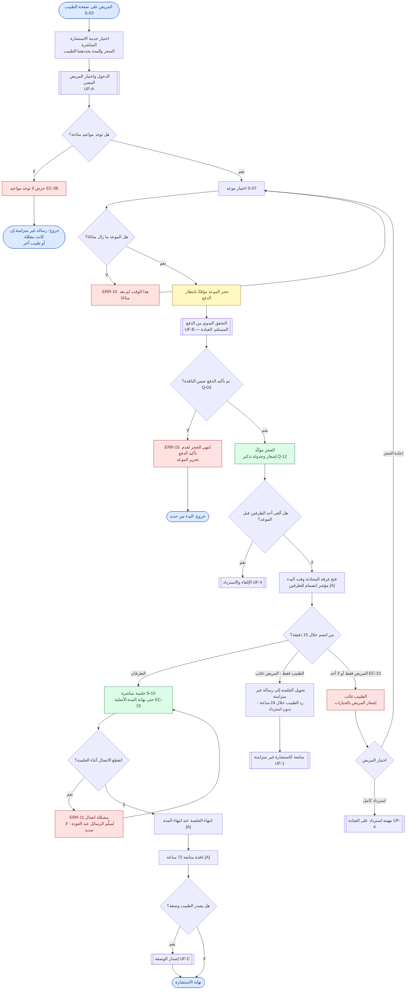

### الشرح

1. يختار المريض الطبيب ثم خدمة **الاستشارة المباشرة**؛ السعر والمدة يحددهما الطبيب (BR-051، FR-032).
2. إذا لم تتوفر مواعيد تظهر "لا توجد مواعيد"، ويبقى خيار الرسالة غير المتزامنة إن كان مفعّلًا (EC-08).
3. عند اختيار موعد يُحجز مؤقتًا بانتظار الدفع (FR-033). إذا سبقه مريض آخر — أوّل من **بدأ الدفع** يأخذ الموعد — تظهر ERR-10 (EC-21).
4. **الدفع مسبق إلى محفظة العيادة**، والحجز لا يُؤكَّد إلا بعد تأكيد العيادة للدفع (BR-050، BR-052). إن لم يُؤكَّد ضمن النافذة يُحرَّر الموعد (ERR-15).
5. **عند وقت البدء:**
   - **المريض غائب بعد 15 دقيقة:** تتحول الجلسة إلى رسالة غير متزامنة ويرد الطبيب خلال 24 ساعة، **بدون استرداد** (BR-053).
   - **الطبيب غائب بعد 15 دقيقة:** يختار المريض **إعادة الحجز** أو **استردادًا كاملًا** (BR-054). غياب الطرفين يُعامَل كغياب الطبيب (EC-13 [A]).
   - **تأخر الطبيب داخل الـ15 دقيقة:** تستمر الجلسة حتى الوقت الأصلي للانتهاء (EC-15 [A]).
6. انقطاع الاتصال لا يُنهي المحادثة؛ تُستكمل بشكل غير متزامن دون تمديد (EC-14، ERR-11).
7. بعد انتهاء المدة تنطبق نافذة المتابعة 72 ساعة، ويمكن إصدار وصفة.

### متطلبات PRD المرتبطة
US-05، BR-050 – BR-056، FR-032 – FR-038، FR-090، AC-18 – AC-21، EC-13 – EC-15، EC-21، ERR-10، ERR-11، ERR-15.

### أسئلة مفتوحة
- **Q-07:** هل يمكن أن تكون الاستشارة المباشرة مجانية؟ (المخطط يفترض أنها مدفوعة دائمًا — BR-056 [A]).
- **Q-03:** مدة الحجز المؤقت بانتظار تأكيد الدفع.
- **Q-12:** توقيت تذكير الحجز.
- **Q-18:** الحد الأدنى للمهلة قبل الموعد لإمكانية الحجز.

---

## UF-3 — حجز الزيارة الحضورية

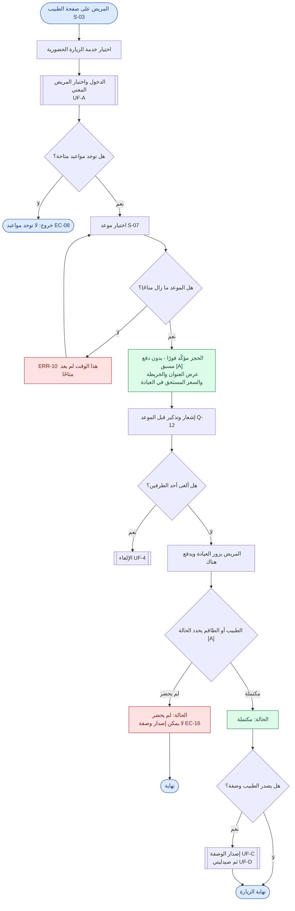

### الشرح

1. يختار المريض الطبيب ثم **زيارة حضورية** ثم موعدًا. لا يوجد دفع عبر المنصة؛ الدفع في العيادة (BR-060).
2. يُؤكَّد الحجز فور اختيار الموعد (BR-061 [A])، ويُعرض عنوان العيادة والخريطة والسعر المستحق (FR-040).
3. بعد الزيارة يحدد الطبيب أو الطاقم الحالة: **مكتملة** أو **لم يحضر** (BR-062 [A]، FR-041).
4. **الوصفة متاحة فقط للزيارات المكتملة** (FR-042)؛ في حالة عدم الحضور لا تُصدَر وصفة (EC-16).
5. بعد الوصفة يكمل المريض في صيدليتي (UF-1 الخطوات 8–13 في PRD = UF-D هنا).

### متطلبات PRD المرتبطة
US-06، BR-060 – BR-062، FR-039 – FR-042، AC-22، AC-23، EC-16، ERR-10.

### أسئلة مفتوحة
- **Q-12:** توقيت التذكير.
- **Q-18:** أقل مهلة للحجز قبل الموعد.
- PRD لا يحدد أي أثر لتكرار عدم الحضور على المريض.

---

## UF-B — التحقق اليدوي من الدفع (تدفّق فرعي مشترك)

يُستدعى من: الرسالة المدفوعة (UF-1)، الاستشارة المباشرة (UF-2)، طلب الصيدلية (UF-D).

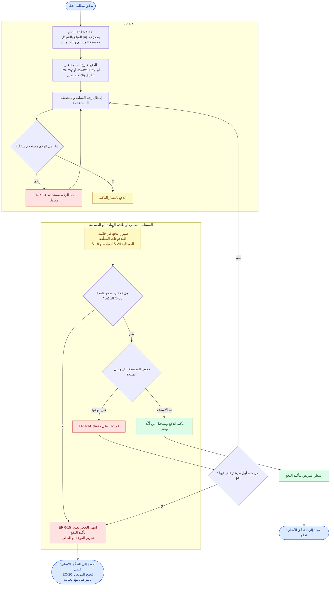

### الشرح

1. **المنصة لا تستلم أي أموال**؛ الدفع يتم مباشرة من محفظة المريض إلى محفظة العيادة أو الصيدلية (BR-070).
2. تعرض المنصة المبلغ ومعرّف محفظة المستلم والتعليمات (FR-047). يدفع المريض في تطبيق المحفظة، ثم يُدخل **رقم العملية** ونوع المحفظة (BR-072، FR-048). **لا تُستخدم صور الإيصالات** (BR-074).
3. رقم العملية يُستخدم مرة واحدة فقط على المنصة (BR-075 [A]، ERR-13).
4. **المستلم** (الطبيب أو طاقم العيادة للعيادات، والصيدلية للطلبات) يفحص محفظته ويختار **تم الاستلام** أو **غير موجود** (BR-073، FR-050).
5. عند "غير موجود" يُشعَر المريض ويُسمح له **بتصحيح الرقم مرة واحدة** قبل تحرير الحجز (FR-051 [A]).
6. إذا لم يُؤكَّد الدفع ضمن **نافذة التأكيد** يُحرَّر الموعد أو الطلب (BR-076، FR-052) — مدة النافذة سؤال مفتوح.
7. كل تأكيد يُسجَّل (من ومتى) (FR-053، NFR-011).

### متطلبات PRD المرتبطة
US-07، US-16، BR-070 – BR-077، FR-047 – FR-053، FR-078، AC-26 – AC-29، EC-18 – EC-21، ERR-13 – ERR-15، INT-1.

### أسئلة مفتوحة
- **Q-03:** مدة نافذة تأكيد الدفع، وهل يوجد تصعيد إذا لم يرد المستلم أبدًا (EC-20).
- **Q-08:** حل النزاعات — المريض يقول إنه دفع والعيادة تقول لا، أو دفع مبلغًا خاطئًا (EC-19). لا يوجد مسار بعد التصحيح الواحد.
- عملة العرض بالشيكل (BR-077) وتصحيح واحد فقط (FR-051) افتراضان.

---

## UF-C — إصدار الوصفة الإلكترونية (الطبيب)

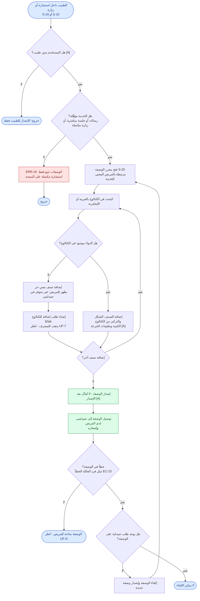

### الشرح

1. يحق للطبيب فقط إصدار وصفة (BR-083 [A])، وذلك **فقط بعد خدمة تمت عبر المنصة**: رسالة غير متزامنة، أو جلسة مباشرة، أو زيارة حضورية مكتملة (BR-080، ERR-16).
2. تُختار الأصناف من **الكتالوج الموحّد** بالبحث بالعربية أو الإنجليزية (BR-081، FR-055).
3. إذا لم يوجد الدواء يضيف الطبيب **صنفًا نصيًا حرًا** يظهر للمريض "غير متوفر في صيدليتي"، ويُرسَل تلقائيًا **طلب إضافة للكتالوج** إلى المشرف (BR-082، FR-056).
4. بعد الإصدار تصل الوصفة إلى صيدليتي ويُشعَر المريض (FR-058).
5. لا تُعدَّل الوصفة بعد إصدارها؛ يمكن إلغاؤها وإصدار أخرى **فقط إذا لم يوجد طلب صيدلية عليها** (BR-085 [A]، FR-059، EC-23).

### متطلبات PRD المرتبطة
US-13، US-14، BR-080 – BR-089، FR-054 – FR-063، AC-30 – AC-32، EC-22 – EC-24، ERR-16.

### أسئلة مفتوحة
- **Q-19:** هل يمكن طلب نفس الوصفة أكثر من مرة (إعادة صرف)؟ وما مدة صلاحية الوصفة؟
- **Q-14:** المتطلبات التنظيمية للوصفات الإلكترونية والأدوية التي تحتاج وصفة.
- عدم قابلية التعديل بعد الإصدار (BR-085) افتراض.

---

## UF-D — صيدليتي: البحث والطلب والدفع والاستلام

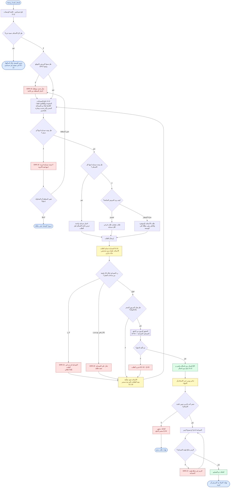

### الشرح

1. يصل إشعار بالوصفة ويفتح المريض **صيدليتي**. الأصناف النصية الحرة لا تُطابَق مع أي صيدلية (BR-125)؛ إذا كانت كل الأصناف نصية تظهر الوصفة فقط (EC-22).
2. **الموقع:** GPS أولًا، وإن رُفض أو فشل يختار المريض منطقته من قائمة (BR-120، ERR-19، EC-25).
3. **النتائج:** فقط الصيدليات المفتوحة وغير المخفية (BR-124)، مرتبة: من لديها كل الأصناف أولًا ثم حسب المسافة (BR-121، FR-066)، مع السعر و"آخر تحديث" (BR-122)، وشارة "قديم" إذا مرّ أكثر من 48 ساعة (BR-134 [A]، EC-27).
4. إذا لم تتوفر أي صيدلية تظهر ERR-18 مع خيار تغيير المنطقة أو المحاولة لاحقًا (FR-070).
5. إذا لم تملك صيدلية واحدة كل الأصناف، يختار المريض **التقسيم** على عدة صيدليات أو **شراء المتوفر** وترك الباقي معلّقًا (BR-123، FR-067، FR-068). نافذة الاستلام تُعرض قبل الطلب (FR-069).
6. **الصيدلية** ترى الأصناف فقط بدون تشخيص (FR-077، SEC-02)، وعليها القبول أو الرفض خلال **30 دقيقة من ساعات عملها**، وإلا يُلغى الطلب تلقائيًا (BR-131، FR-075، FR-076). الرفض يتضمن سببًا (BR-133 [A]).
7. عند الرفض أو الإلغاء التلقائي تعود الأصناف معلّقة، ويختار المريض صيدلية أخرى؛ والطلبات الفرعية الأخرى تستمر (EC-28).
8. **الدفع بعد القبول فقط**، والسعر المقبول هو المعتمد (BR-132). يمكن للمريض الرفض قبل الدفع إن تغيّر السعر (EC-30 [A]).
9. بعد تأكيد الصيدلية للدفع يُصدَر **رمز استلام** (رقمي + QR) متاح دون اتصال (BR-095، FR-079، FR-080). **أي شخص يحمل الرمز يستطيع الاستلام** (BR-096). تذكير يومي حتى الاستلام أو الانتهاء (BR-098).
10. تُدخل الصيدلية أو تمسح الرمز؛ إن كان لصيدلية أخرى تظهر ERR-22، وإلا يُعلَّم الطلب **تم التسليم** (FR-081).
11. إذا انتهت نافذة الاستلام يصبح الطلب **منتهيًا** (FR-083)، ومصير الدفع سؤال مفتوح (Q-04).

### متطلبات PRD المرتبطة
US-09 – US-11، US-19 – US-21، BR-095 – BR-099، BR-120 – BR-134، FR-064 – FR-083، AC-35 – AC-47، EC-22، EC-25 – EC-34، ERR-18 – ERR-22، SEC-02، SEC-10، NFR-005.

### أسئلة مفتوحة
- **Q-04:** عند انتهاء طلب مدفوع دون استلام، هل يُسترد المبلغ كاملًا أو جزئيًا أو لا؟
- **Q-09:** نفاد المخزون بعد القبول والدفع (EC-31): المريض يُسترد له، لكن الإجراء والعواقب غير محددة — لذلك لم يُرسم كمسار في المخطط.
- **Q-03:** مدة انتظار دفع المريض بعد قبول الصيدلية (EC-32).
- **Q-19:** هل يمكن إعادة طلب نفس الوصفة؟ وكيف تُعامَل الأصناف المعلّقة على المدى الطويل؟
- خيار "أعلمني عند التوفر" مؤجَّل للمرحلة 3، فلم يُرسم ضمن ERR-18.

---

## UF-4 — الإلغاء والاسترداد

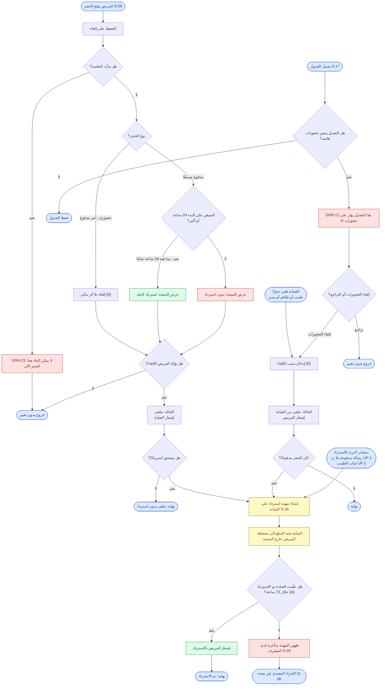

### الشرح

**إلغاء المريض:**
1. يفتح المريض الحجز ويضغط إلغاء. بعد بدء الجلسة لا يمكن الإلغاء (ERR-23).
2. الحجز **الحضوري** يُلغى في أي وقت بلا أثر مالي لأنه غير مدفوع مسبقًا (BR-094 [A]).
3. الحجز **المدفوع**: قبل 24 ساعة أو أكثر ← **استرداد كامل** (BR-090)؛ أقل من 24 ساعة ← **بدون استرداد** (BR-091). الإلغاء عند 24 ساعة تمامًا يُحسب استردادًا (EC-35 [A]).
4. **تُعرض النتيجة قبل التأكيد** (FR-084، AC-48، AC-49).

**إلغاء العيادة:**
5. العيادة تلغي مع ذكر السبب (FR-085 [A]) ← **استرداد كامل دائمًا** للحجز المدفوع (BR-092، AC-50).
6. حذف أوقات من الجدول عليها حجوزات يتطلب إلغاءها، ويُعتبر إلغاءً من العيادة (BR-068 [A]، ERR-12).

**تنفيذ الاسترداد:**
7. تُنشأ **مهمة استرداد** على العيادة (FR-086). العيادة تُعيد المبلغ مباشرة إلى محفظة المريض ثم تُعلّم "تم الاسترداد"، ويُشعَر المريض (BR-093).
8. المهام المتأخرة أكثر من 72 ساعة تظهر للمشرف (FR-087 [A]، EC-36). ما يفعله المشرف بعدها غير محدد (Q-08).

### متطلبات PRD المرتبطة
US-08، BR-068، BR-090 – BR-094، BR-043، BR-054، FR-084 – FR-087، AC-48 – AC-50، EC-35، EC-36، ERR-12، ERR-23.

### أسئلة مفتوحة
- **Q-08:** آلية إلزام العيادة بالاسترداد ودور المشرف في النزاعات.
- إلغاء رسالة غير متزامنة مدفوعة قبل الرد: غير مذكور في PRD (الإلغاء معرَّف للحجوزات فقط).
- مهلة 72 ساعة للتأخير (FR-087) افتراض.

---

## UF-5 — تسجيل العيادة والأطباء والاشتراك

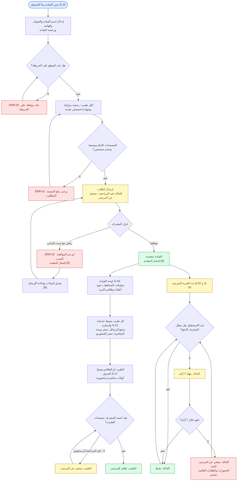

### الشرح

1. يسجّل **مدير العيادة** العيادة ذاتيًا: الاسم والعنوان والخريطة والهاتف ورخصة العيادة، ولكل طبيب رخصة مزاولة وشهادة اختصاص جلدية (BR-003، FR-001، FR-002). لا يُسمح بطبيب بلا عيادة فعلية (BR-001)، والعيادة الخاصة = عيادة بطبيب واحد (BR-002).
2. نقص مستند يمنع الإرسال (ERR-01، AC-01)، وكذلك عدم تحديد الموقع (ERR-03، AC-05).
3. بعد الإرسال تصبح الحالة **قيد المراجعة** والعيادة **مخفية** (BR-004، FR-003، AC-02).
4. **المشرف** يوافق أو يرفض مع **سبب إلزامي** (FR-004، AC-03). المرفوض يعدّل ويعيد الإرسال (BR-007 [A]).
5. بعد الموافقة: يضبط المدير معرّفات المحافظ ويدعو الأطباء والطاقم بالبريد (FR-007)، ويضبط كل طبيب خدماته وأسعاره، ويُضبط الجدول من الطبيب أو الطاقم (BR-065، FR-043).
6. **كل طبيب** يبقى مخفيًا حتى يعتمد المشرف مستنداته (BR-005، FR-008، AC-04). العيادة بلا أطباء ظاهرين لا تُعرض (EC-01 [A]).
7. **الاشتراك:** فترة تجريبية ثم اشتراك شهري (BR-111). عند عدم الدفع في موعد الاستحقاق تبدأ **مهلة 7 أيام**، ثم **يُخفى الشريك عن المرضى الجدد** مع استمرار الحجوزات القائمة (BR-113، FR-093، FR-094، AC-52، AC-53). الدفع يسجّله المشرف يدويًا (BR-114).

### متطلبات PRD المرتبطة
US-15، US-17، US-22، US-24، BR-001 – BR-007، BR-065 – BR-068، BR-110 – BR-114، FR-001 – FR-009، FR-043 – FR-046، FR-091 – FR-094، AC-01 – AC-05، AC-24، AC-25، AC-52، AC-53، EC-01 – EC-04، EC-38، ERR-01 – ERR-03.

### أسئلة مفتوحة
- **Q-02 / Q-05 / Q-06:** متى تبدأ الفترة التجريبية، ومدتها، وأسعار الاشتراك.
- **Q-15:** هل يمكن أن يكون مدير العيادة طبيبًا في نفس الحساب؟
- **EC-04:** تغيير عنوان العيادة يتطلب إعادة مراجعة مع إبقائها ظاهرة — افتراض لم يُرسم كمسار منفصل.
- لا يحدد PRD هل يمكن إعادة إظهار شريك "مخفي" فور الدفع (المخطط يعيده لدورة الاستحقاق فقط).

---

## UF-6 — تسجيل الصيدلية وتشغيلها اليومي

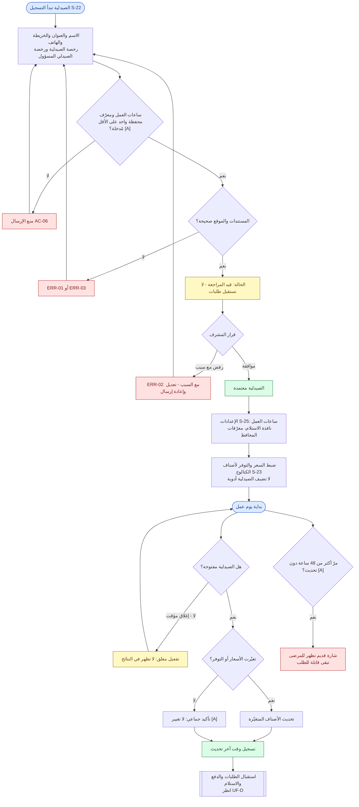

### الشرح

1. **التسجيل** بنفس طريقة العيادات: تسجيل ذاتي، رفع مستندات، اعتماد المشرف (BR-010، FR-012). المستندات المطلوبة مشتقة من "نفس العيادات" (BR-011 [A]).
2. ساعات العمل ومعرّف محفظة واحد على الأقل إلزاميان (BR-012، BR-013، FR-011 [A]، AC-06)، لأن ساعات العمل تُستخدم في قاعدة الـ30 دقيقة وفي إخفاء الصيدليات المغلقة.
3. بعد الاعتماد تضبط الصيدلية نافذة الاستلام (BR-097) والسعر والتوفر **لأصناف الكتالوج فقط** (BR-089، FR-071).
4. **يوميًا:** تحديث الأسعار والتوفر (BR-130)، مع شاشة تأكيد سريع "لا تغيير" (FR-072 [A]). كل تحديث يُسجَّل وقته ويُعرض (FR-073).
5. يمكن تفعيل **مغلق مؤقتًا** (مثلًا أثناء انقطاع الكهرباء) فتختفي من النتائج (FR-013 [A]، EC-05، AC-07).
6. عدم التحديث لأكثر من 48 ساعة يُظهر شارة "قديم" (BR-134 [A]).
7. الاشتراك يتبع نفس دورة العيادة في UF-5.

### متطلبات PRD المرتبطة
US-18، US-19، US-22، BR-010 – BR-013، BR-089، BR-097، BR-130، BR-134، FR-010 – FR-013، FR-071 – FR-073، AC-06، AC-07، EC-05، ERR-01 – ERR-03.

### أسئلة مفتوحة
- **Q-16:** هل تحتاج الصيدلية أكثر من حساب موظف؟
- **Q-02 / Q-05 / Q-06:** بداية الفترة التجريبية ومدتها والأسعار.
- قائمة المستندات المطلوبة (BR-011) وإلزامية ساعات العمل والمحفظة (FR-011) افتراضات.

---

## UF-7 — لوحة المشرف

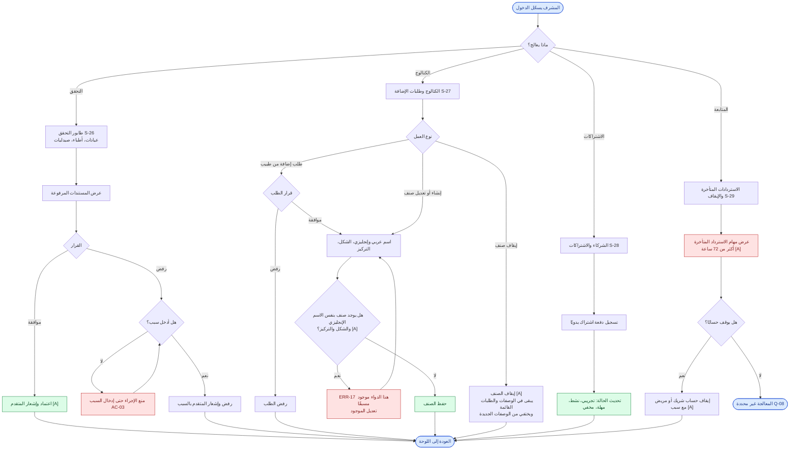

### الشرح

1. **طابور التحقق:** يراجع المشرف مستندات العيادات والأطباء والصيدليات، ويوافق أو يرفض؛ **الرفض يتطلب سببًا** (FR-004، FR-095، AC-03).
2. **الكتالوج:** المشرف وحده ينشئ ويعدّل ويوقف الأصناف (BR-087، FR-060)، وكل صنف له اسم عربي وإنجليزي (BR-088). يعالج طلبات الإضافة القادمة من الأطباء (FR-061). التكرار ممنوع (FR-062 [A]، ERR-17). الصنف الموقوف يبقى في الوصفات والطلبات القائمة (FR-063 [A]، EC-24).
3. **الاشتراكات:** يسجّل المشرف الدفعات يدويًا ويتابع الحالات (BR-114، FR-091، FR-092).
4. **المتابعة:** يرى مهام الاسترداد المتأخرة (FR-087 [A]) ويمكنه إيقاف أي حساب مع ذكر السبب (FR-098 [A]).
5. **لا يصل المشرف إلى المحتوى الطبي** في الـ MVP (FR-099 [A]).

### متطلبات PRD المرتبطة
US-22 – US-24، BR-004، BR-005، BR-087، BR-088، BR-113، BR-114، FR-004، FR-060 – FR-063، FR-087، FR-091 – FR-099، AC-03، AC-33، AC-34، AC-52، EC-24، ERR-17.

### أسئلة مفتوحة
- **Q-08:** ما الإجراء المطلوب من المشرف عند الاستردادات المتأخرة أو النزاعات؟
- **Q-10:** هل يصل المشرف إلى المحتوى الطبي لحل النزاعات أو البلاغات؟
- **Q-20:** من يُعِدّ الكتالوج الأولي وقائمة المناطق؟
- صلاحية الإيقاف (FR-098) وإشعار المتقدم بالقرار (FR-005) افتراضات.

---

## ملخّص الأسئلة المفتوحة المؤثّرة على التدفقات

| السؤال | التدفقات المتأثرة | الأثر على التصميم |
|---|---|---|
| Q-03 مدة نافذة تأكيد الدفع والتصعيد | UF-1، UF-2، UF-B، UF-D | مدة العدّاد على شاشة الدفع، ونص رسالة ERR-15 |
| Q-04 مصير دفع الطلب المنتهي | UF-D | ما يراه المريض عند حالة "منتهي" |
| Q-07 هل المباشرة مجانية أحيانًا؟ | UF-2 | تخطّي خطوة الدفع إن سُمح بالمجاني |
| Q-08 النزاعات وإلزام الاسترداد | UF-B، UF-4، UF-7 | مسار ما بعد التصحيح الواحد ومسار الاسترداد المتأخر |
| Q-09 نفاد المخزون بعد الدفع | UF-D | مسار استرداد من الصيدلية غير مرسوم |
| Q-10 وصول المشرف للمحتوى الطبي | UF-0، UF-7 | شاشات إضافية للمشرف إن سُمح |
| Q-12 توقيت التذكيرات | UF-2، UF-3 | جدولة الإشعارات |
| Q-15 مدير العيادة طبيب أيضًا؟ | UF-0، UF-5 | تبديل الأدوار في التنقّل |
| Q-16 تعدد حسابات الصيدلية | UF-0، UF-6 | إدارة موظفي الصيدلية |
| Q-18 أقل مهلة للحجز | UF-2، UF-3 | إخفاء المواعيد القريبة جدًا |
| Q-19 إعادة صرف الوصفة وصلاحيتها | UF-C، UF-D | حالة الوصفة بعد الطلب |
| Q-02 / Q-05 / Q-06 الاشتراك | UF-5، UF-6 | بداية الفترة التجريبية ومدتها |
