# مخططات تدفّق المستخدم (User Flows) — التِئام (Iltiam)

| الحقل | القيمة |
|---|---|
| المصدر | [PRD.md](PRD.md) — المسودة v1.2 (2026-10-27) |
| التاريخ | 2026-10-22 · حُدِّث في 2026-10-27 ليطابق PRD v1.1 |
| النطاق | رحلات الـ MVP المؤكَّدة فقط (PRD §9.1 و§13) |
| الصيغة | Mermaid `flowchart TD` |
| النسخة الإنجليزية | [user-flow.md](user-flow.md) |

## كيف تقرأ هذا المستند

- كل مخطط يغطي رحلة واحدة، ويليه **شرح بالعربية** ثم **متطلبات PRD المرتبطة** ثم **أسئلة مفتوحة** خاصة به.
- لم تُضَف أي قاعدة عمل غير موجودة في الـ PRD. الخطوات المبنية على **افتراض [A]** في الـ PRD موسومة بـ `[A]` داخل المخطط، والخطوات المتوقفة على **سؤال مفتوح** موسومة برقم السؤال (مثل `Q-04`).
- أرقام الشاشات (`S-xx`) وحالات الخطأ (`ERR-xx`) والحالات الطرفية (`EC-xx`) مأخوذة كما هي من الـ PRD.
- القواعد المضافة في PRD v1.1 (فوّضها صاحب المنتج، وموسومة **[D]** في الـ PRD) مرسومة كالقواعد المؤكَّدة، مع ذكر رقمها لسهولة التتبُّع (مثل `BR-048`).
- القواعد المضافة في PRD v1.2 جاءت من إجابات صاحبة المنتج عن الأسئلة المفتوحة (موسومة **[C]** في الـ PRD)، ومرسومة كقواعد مؤكدة (مثل `BR-135`).

### دليل الألوان والأشكال

| الشكل / اللون | المعنى |
|---|---|
| `([ ... ])` أزرق | نقطة دخول أو خروج |
| `[ ... ]` | إجراء المستخدم أو استجابة النظام |
| `{ ... }` | نقطة قرار |
| `[[ ... ]]` | تدفّق فرعي مشترك (موضَّح في مخطط مستقل) |
| أخضر | مسار نجاح |
| أحمر | حالة خطأ أو مسار فشل |
| أصفر | حالة انتظار أو تعليق |

### فهرس التدفقات

| # | التدفّق | الأدوار | ميزات PRD |
|---|---|---|---|
| UF-0 | التنقّل حسب الدور | الجميع | §14، §15 |
| UF-A | التسجيل والدخول وأفراد العائلة | زائر، مريض | F-03، F-04 |
| UF-1 | الاستشارة بالرسائل غير المتزامنة | مريض، طبيب | F-05 |
| UF-2 | الاستشارة النصية المباشرة المحجوزة (Should Have) | مريض، طبيب | F-06 |
| UF-3 | حجز الزيارة الحضورية | مريض، طبيب، طاقم العيادة | F-07 |
| UF-B | التحقق اليدوي من الدفع (تدفّق فرعي) | مريض، طبيب/طاقم، صيدلية | F-09 |
| UF-C | إصدار الوصفة الإلكترونية | طبيب | F-10، F-11 |
| UF-D | صيدليتي: الطلب والاستلام | مريض، صيدلية | F-12، F-13، F-14 |
| UF-4 | الإلغاء والاسترداد | مريض، عيادة، مشرف | F-15، F-08 |
| UF-5 | تسجيل العيادة والطبيب والاشتراك | مدير العيادة، طبيب، طاقم، مشرف | F-01، F-08، F-17 |
| UF-6 | تسجيل الصيدلية وتشغيلها اليومي | صيدلية، مشرف | F-02، F-13 |
| UF-7 | لوحة المشرف والبلاغات | مشرف المنصة | F-11، F-17، F-18 |

---

## UF-0 — التنقّل حسب الدور

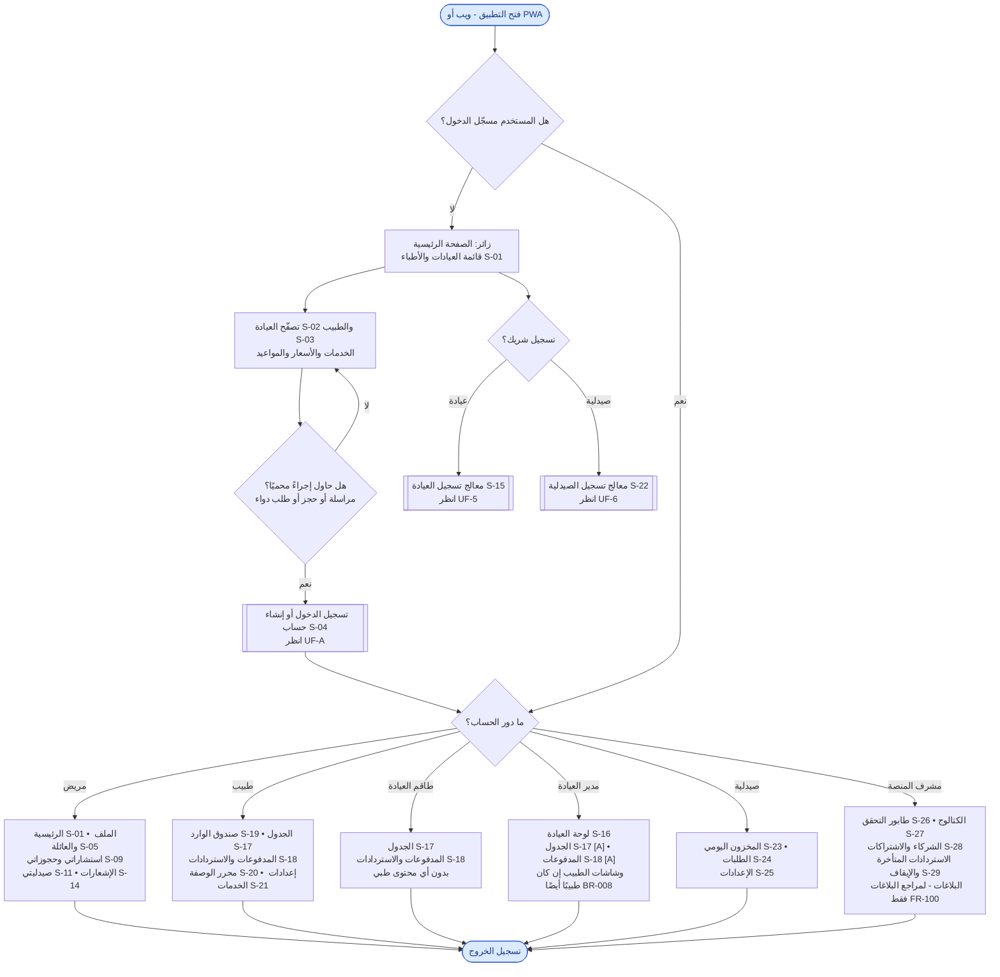

### الشرح

- **الزائر** يتصفّح العيادات والأطباء المعتمَدين والخدمات والأسعار دون حساب (BR-020). عند أي إجراء محمي يُطلب منه الدخول أو التسجيل، ثم يعود إلى نفس الإجراء (FR-023).
- يمكن للزائر أيضًا بدء **تسجيل شريك** (عيادة أو صيدلية) عبر معالج التسجيل الخاص.
- بعد الدخول يُوجَّه كل مستخدم إلى الشاشات التي يسمح بها دوره حسب مصفوفة الصلاحيات (§15):
  - **طاقم العيادة** يرى الجدول والمدفوعات فقط، **ولا يرى أي محتوى طبي** (SEC-03، FR-031).
  - **المشرف** لا يصل إلى المحتوى الطبي بشكل عام (FR-099). الاستثناء الوحيد هو **مراجع البلاغات**، ويرى الرسائل المُبلَّغ عنها فقط (FR-100).
  - وصول **مدير العيادة** إلى الجدول وتأكيد المدفوعات افتراض [A]. المدير الذي هو طبيب أيضًا تظهر له شاشات الطبيب، ولا يرى المحتوى الطبي إلا من خلال دور الطبيب (BR-008).
- الإشعارات (S-14) متاحة لكل الأدوار المسجّلة.

### متطلبات PRD المرتبطة
BR-008، BR-020، FR-020، FR-023، §14 (S-01 – S-29)، §15، SEC-01، SEC-03، FR-031، FR-099، FR-100.

### أسئلة مفتوحة
- **Q-10:** وصول المشرف إلى المحتوى المُبلَّغ عنه فقط (FR-100) يحتاج تأكيدًا قانونيًا.
- حُسم في PRD v1.1: السؤال Q-15 (يمكن لمدير العيادة أن يكون طبيبًا، BR-008).
- حُسم في PRD v1.2: السؤال Q-16 (حساب صيدلية واحد مشترك، BR-014). كل المشرفين لهم نفس الصلاحيات ما عدا مراجع البلاغات (§15).

---

## UF-A — التسجيل والدخول وأفراد العائلة

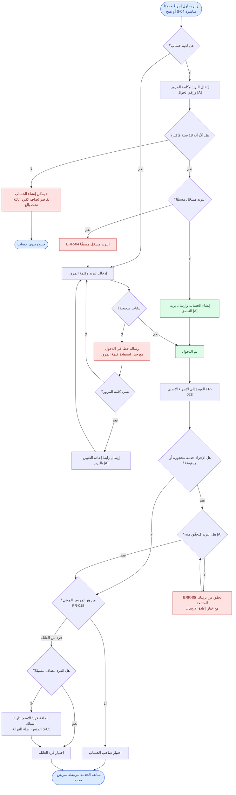

### الشرح

1. يصل الزائر إلى هذا التدفّق عند محاولة مراسلة طبيب أو حجز موعد أو طلب دواء، أو بفتح شاشة الدخول مباشرة.
2. **التسجيل** يكون بالبريد الإلكتروني وكلمة المرور فقط (BR-021). يجب تأكيد أن صاحب الحساب **بالغ (18+)**، وإلا لا يُنشأ الحساب (AC-10). القاصر لا يستخدم المنصة منفردًا، بل يُضاف كفرد عائلة (EC-06).
3. إذا كان البريد مسجّلًا يظهر ERR-04 ويُحوَّل المستخدم للدخول أو استعادة كلمة المرور.
4. بعد الدخول يعود المستخدم **إلى نفس الإجراء** الذي بدأه (FR-023، AC-08).
5. قبل أول خدمة مدفوعة أو محجوزة يُشترط التحقق من البريد (BR-024 — افتراض [A]).
6. لكل استشارة أو حجز أو طلب يجب اختيار **المريض المعني** (صاحب الحساب أو أحد أفراد العائلة) (BR-023، FR-018، AC-09)، ويمكن إضافة فرد جديد أثناء التدفّق. حذف فرد من العائلة يؤرشفه: يختفي من هذه القائمة، ويبقى سجلّه محفوظًا (FR-017، EC-46).

### متطلبات PRD المرتبطة
US-02، US-03، BR-020 – BR-025، FR-014 – FR-019، FR-023، AC-08 – AC-10، EC-06، EC-07، EC-46، ERR-04، ERR-05.

### أسئلة مفتوحة
- التحقق من البريد قبل أول خدمة (BR-024) وجمع رقم الجوال (BR-025) افتراضان يحتاجان تأكيدًا (§26.3).
- PRD لا يحدد ما يحدث عند خطأ الدخول المتكرر سوى "تقييد المحاولات" (SEC-07)؛ رسالة القفل وتوقيته غير محدَّدين.

---

## UF-1 — الاستشارة بالرسائل غير المتزامنة

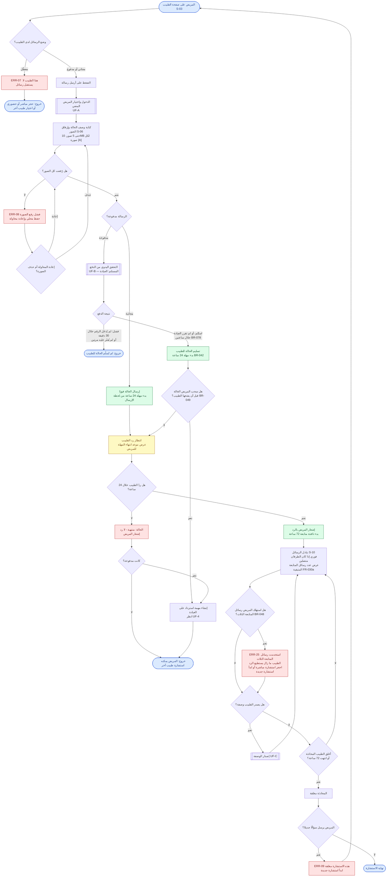

### الشرح

1. **نقطة البداية:** صفحة الطبيب. يحدد الطبيب وضع الرسائل: مجاني (افتراضي)، أو مدفوع بسعره، أو معطّل (BR-040). إذا كان معطّلًا يُقترح على المريض حجز استشارة مباشرة أو حضورية أو طبيب آخر (ERR-07).
2. يدخل المريض (أو يسجّل) ويختار **المريض المعني**، ثم يكتب الحالة ويرفق الصور (BR-046). حدود الصور افتراض [A] (BR-047). إذا فشل رفع صورة تُحفظ محليًا ويُعاد المحاولة، ولا تُرسَل الرسالة حتى تكتمل الصور أو تُحذف الفاشلة (EC-12).
3. **الرسالة المجانية** تُرسل فورًا وتبدأ مهلة 24 ساعة. **الرسالة المدفوعة** تمرّ بتدفّق الدفع اليدوي (UF-B) أولًا، وتبدأ المهلة عند تأكيد العيادة للدفع، أو تلقائيًا إذا لم تقرر العيادة خلال ساعتين (BR-042، BR-076، BR-078).
   - قبل أن يفتح الطبيب الحالة المدفوعة، يستطيع المريض **سحبها** واسترداد المبلغ كاملًا (BR-049، FR-030b).
4. **إذا لم يردّ الطبيب خلال 24 ساعة:** تصبح الحالة "منتهية - لا رد"، يُشعَر المريض ويمكنه استشارة طبيب آخر، وإذا كانت مدفوعة تُنشأ مهمة استرداد على العيادة (BR-043، FR-029).
5. **بعد أول رد:** تبقى المحادثة مفتوحة 72 ساعة للمتابعة، ويمكن للطبيب إغلاقها مبكرًا (BR-044). الرسائل فورية إن كان الطرفان متصلين (BR-045). يستطيع المريض إرسال **3 رسائل متابعة** فقط، ويظهر له العدد المتبقي. عند الصفر تظهر ERR-25 وتقترح استشارة مباشرة مدفوعة أو استشارة جديدة. ردود الطبيب غير محدودة (BR-048، FR-030a، EC-47).
6. يمكن للطبيب إصدار وصفة أثناء الاستشارة (UF-C).
7. بعد الإغلاق تُعطَّل خانة الكتابة ويُطلب بدء استشارة جديدة (EC-11، ERR-09).
8. **الخصوصية:** محتوى الحالة والصور يراه المريض والطبيب المعالج فقط، لا طاقم العيادة ولا المشرف (FR-031، SEC-01).
9. **البلاغات:** يستطيع المريض أو الطبيب الإبلاغ عن رسالة. تُشارَك الرسائل المُبلَّغ عنها فقط مع مراجع البلاغات لمدة 14 يومًا، وتُسجَّل كل مشاهدة (FR-100، SEC-13). انظر UF-7.

### متطلبات PRD المرتبطة
US-04، US-12، BR-040 – BR-049، BR-076، BR-078، FR-024 – FR-031، FR-030a، FR-030b، FR-100، AC-12 – AC-17، AC-16a، AC-17a، AC-29a، EC-09 – EC-12، EC-47، ERR-07 – ERR-09، ERR-25، SEC-01، SEC-05، SEC-13، NFR-004، NFR-006.

### أسئلة مفتوحة
- حدّ رسائل المتابعة (3، BR-048) ومهلة العيادة (ساعتان، BR-076) قاعدتان مفوَّضتان [D] تُختبَران في التجربة.
- **EC-10:** مهلة 24 ساعة تحكم الرد الأول فقط؛ المتابعات "أفضل جهد" — هل يُعرض للمريض أي توقّع لزمن الرد بعد الرد الأول؟ (غير محدد في PRD).

---

## UF-2 — الاستشارة النصية المباشرة المحجوزة

> **ميزة Should Have (مرغوبة لا ضرورية، PRD QR-17).** تُبنى بعد الرحلة الأساسية، وهي أول ما يُؤجَّل إذا تأخر الجدول الزمني. الرسائل غير المتزامنة تصل فورًا أصلًا، ضمن حدّ المتابعة في BR-048.

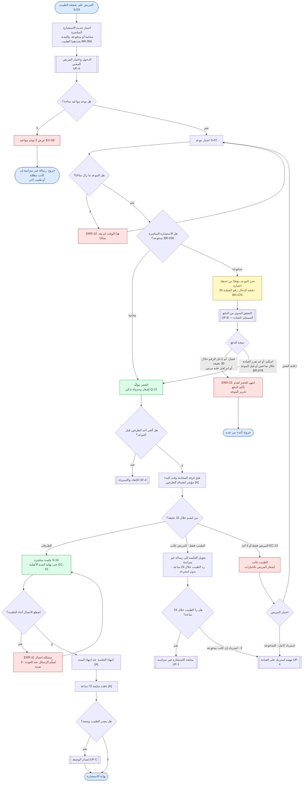

### الشرح

1. يختار المريض الطبيب ثم خدمة **الاستشارة المباشرة**. الطبيب يقرر إن كانت مجانية أو مدفوعة، ويحدد المدة (BR-051، BR-056، FR-032).
2. إذا لم تتوفر مواعيد تظهر "لا توجد مواعيد"، ويبقى خيار الرسالة غير المتزامنة إن كان مفعّلًا (EC-08).
3. يُحجز الموعد مؤقتًا **من لحظة اختياره** (FR-033). إذا سبقه مريض آخر تظهر ERR-10 (EC-21).
4. الجلسة **المجانية** تتأكد بمجرد اختيار الموعد (BR-052). أما الجلسة **المدفوعة** فالدفع فيها **مسبق إلى محفظة العيادة**، والحجز يُؤكَّد بعد تأكيد العيادة للدفع (BR-050، BR-052). أمام المريض **30 دقيقة** لإدخال رقم العملية، وإلا يُحرَّر الموعد (ERR-15). إذا لم تقرر العيادة خلال **ساعتين** أو قبل بدء الجلسة، يُؤكَّد الحجز ويصل تنبيه للمشرف (BR-076، BR-078).
5. **عند وقت البدء:**
   - **المريض غائب بعد 15 دقيقة:** تتحول الجلسة إلى رسالة غير متزامنة ويرد الطبيب خلال 24 ساعة، **بدون استرداد** (BR-053). إذا لم يردّ الطبيب خلال 24 ساعة، يُردّ المبلغ للمريض **كاملًا** إن كانت الجلسة مدفوعة (BR-057، EC-41).
   - **الطبيب غائب بعد 15 دقيقة:** يختار المريض **إعادة الحجز** أو، في الجلسة المدفوعة، **استردادًا كاملًا** (BR-054). غياب الطرفين يُعامَل كغياب الطبيب (EC-13 [A]).
   - **تأخر الطبيب داخل الـ15 دقيقة:** تستمر الجلسة حتى الوقت الأصلي للانتهاء (EC-15 [A]).
6. انقطاع الاتصال لا يُنهي المحادثة؛ تُستكمل بشكل غير متزامن دون تمديد (EC-14، ERR-11).
7. بعد انتهاء المدة تنطبق نافذة المتابعة 72 ساعة، ويمكن إصدار وصفة.

### متطلبات PRD المرتبطة
US-05، BR-050 – BR-057، BR-076، BR-078، FR-032 – FR-038، FR-090، AC-18 – AC-21، AC-19a، AC-29b، EC-13 – EC-15، EC-21، EC-41، ERR-10، ERR-11، ERR-15.

### أسئلة مفتوحة
- حُسم في PRD v1.2: السؤال Q-07 (الطبيب يختار مجانية أو مدفوعة، BR-056).
- **Q-12:** توقيت تذكير الحجز.
- **Q-18:** الحد الأدنى للمهلة قبل الموعد لإمكانية الحجز.

---

## UF-3 — حجز الزيارة الحضورية

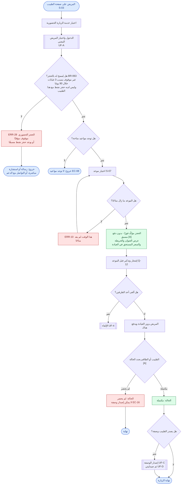

### الشرح

1. يختار المريض الطبيب ثم **زيارة حضورية** ثم موعدًا. لا يوجد دفع عبر المنصة؛ الدفع في العيادة (BR-060).
   - لأن الحجز بلا دفع مسبق، هناك حدود ضد سوء الاستخدام: حجز حضوري نشط واحد لكل مريض مع كل طبيب، والحساب الذي يغيب **3 مرات خلال 90 يومًا** يُمنع من الحجز الحضوري 30 يومًا. يستطيع المشرف رفع المنع (BR-063، ERR-28، AC-23a).
2. يُؤكَّد الحجز فور اختيار الموعد (BR-061 [A])، ويُعرض عنوان العيادة والخريطة والسعر المستحق (FR-040).
3. بعد الزيارة يحدد الطبيب أو الطاقم الحالة: **مكتملة** أو **لم يحضر** (BR-062 [A]، FR-041).
4. **الوصفة متاحة فقط للزيارات المكتملة** (FR-042)؛ في حالة عدم الحضور لا تُصدَر وصفة (EC-16).
5. بعد الوصفة يكمل المريض في صيدليتي (UF-1 الخطوات 8–13 في PRD = UF-D هنا).

### متطلبات PRD المرتبطة
US-06، BR-060 – BR-063، FR-039 – FR-042، AC-22، AC-23، AC-23a، EC-16، ERR-10، ERR-28.

### أسئلة مفتوحة
- **Q-12:** توقيت التذكير.
- **Q-18:** أقل مهلة للحجز قبل الموعد.
- حدود الغياب في BR-063 (3 غيابات خلال 90 يومًا، منع 30 يومًا) قواعد مفوَّضة [D] تُختبَر في التجربة.

---

## UF-B — التحقق اليدوي من الدفع (تدفّق فرعي مشترك)

يُستدعى من: الرسالة المدفوعة (UF-1)، الاستشارة المباشرة (UF-2)، طلب الصيدلية (UF-D).

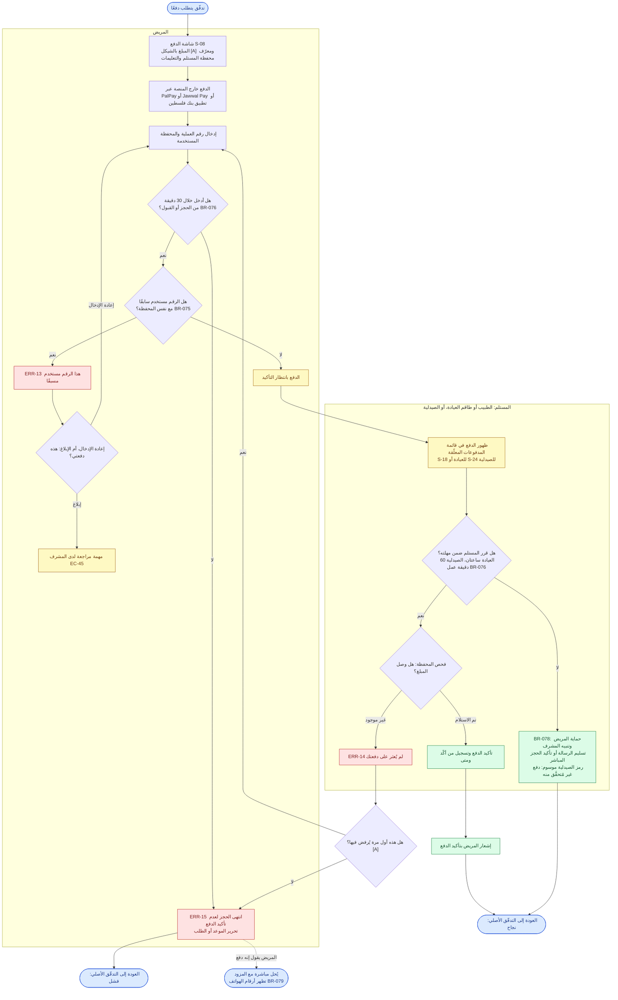

### الشرح

1. **المنصة لا تستلم أي أموال**؛ الدفع يتم مباشرة من محفظة المريض إلى محفظة العيادة أو الصيدلية (BR-070).
2. تعرض المنصة المبلغ ومعرّف محفظة المستلم والتعليمات (FR-047). يدفع المريض في تطبيق المحفظة، ثم يُدخل **رقم العملية** ونوع المحفظة (BR-072، FR-048). **لا تُستخدم صور الإيصالات** (BR-074).
3. **مهلة المريض:** يجب إدخال رقم العملية خلال **30 دقيقة** من حجز الموعد أو قبول الصيدلية، وإلا يُحرَّر الحجز (BR-076، ERR-15، AC-29b).
4. رقم العملية يُستخدم مرة واحدة فقط **لكل محفظة** (BR-075، ERR-13، AC-27). إذا كان المريض متأكدًا أن الرقم له، يضغط "هذه دفعتي" فيراجعها المشرف (EC-45).
5. **المستلم** (الطبيب أو طاقم العيادة للعيادات، والصيدلية للطلبات) يفحص محفظته ويختار **تم الاستلام** أو **غير موجود** (BR-073، FR-050).
6. عند "غير موجود" يُشعَر المريض ويُسمح له **بتصحيح الرقم مرة واحدة** قبل تحرير الحجز (FR-051 [A]).
7. **مهلة المستلم:** على العيادة أن تقرر خلال **ساعتين**، وعلى الصيدلية خلال **60 دقيقة من ساعات عملها**. إذا لم يقرر المستلم، يُحمى المريض ويصل تنبيه للمشرف: تُسلَّم الرسالة المدفوعة، أو يُؤكَّد الحجز المباشر، أو يُصدَر رمز الاستلام موسومًا "دفع غير مُتحقَّق منه" فتفحص الصيدلية محفظتها عند التسليم (BR-078، FR-052، EC-20، AC-29a).
8. كل تأكيد يُسجَّل (من ومتى) (FR-053، NFR-011).
9. **النزاعات:** إذا قال المريض إنه دفع والمزود لم يجد الدفعة، أو كان المبلغ خاطئًا، يحلّانها مباشرة. المنصة لا تتدخل، لكنها تعرض لكل طرف رقم هاتف الآخر (BR-079، EC-19).

### متطلبات PRD المرتبطة
US-07، US-16، BR-070 – BR-078، FR-047 – FR-053، FR-078، AC-26 – AC-29، AC-29a، AC-29b، EC-18 – EC-21، EC-45، ERR-13 – ERR-15، INT-1.

### أسئلة مفتوحة
- مدد BR-076 (30 دقيقة / ساعتان / 60 دقيقة) قواعد مفوَّضة [D] تُختبَر في التجربة.
- حُسم في PRD v1.2: السؤال Q-08 (النزاع يُحل مباشرة بين الطرفين، BR-079).
- عملة العرض بالشيكل (BR-077) وتصحيح واحد فقط (FR-051) افتراضان.

---

## UF-C — إصدار الوصفة الإلكترونية (الطبيب)

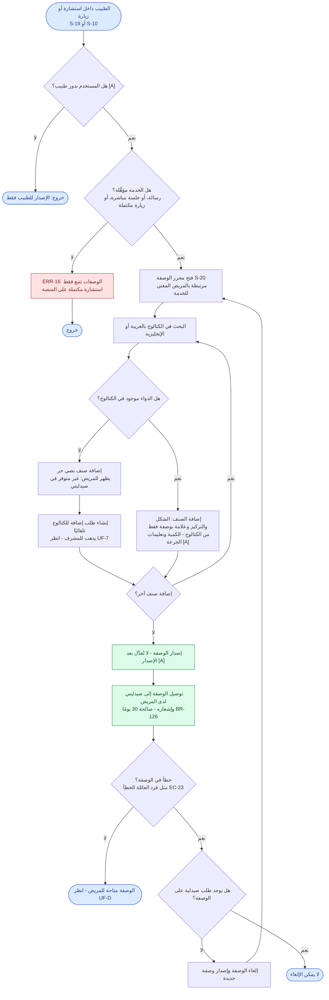

### الشرح

1. يحق للطبيب فقط إصدار وصفة (BR-083 [A])، وذلك **فقط بعد خدمة تمت عبر المنصة**: رسالة غير متزامنة، أو جلسة مباشرة، أو زيارة حضورية مكتملة (BR-080، ERR-16).
2. تُختار الأصناف من **الكتالوج الموحّد** بالبحث بالعربية أو الإنجليزية (BR-081، FR-055).
3. إذا لم يوجد الدواء يضيف الطبيب **صنفًا نصيًا حرًا** يظهر للمريض "غير متوفر في صيدليتي"، ويُرسَل تلقائيًا **طلب إضافة للكتالوج** إلى المشرف (BR-082، FR-056).
4. بعد الإصدار تصل الوصفة إلى صيدليتي ويُشعَر المريض (FR-058). الوصفة **صالحة 30 يومًا**، وكل صنف يُصرف **مرة واحدة** (BR-126، BR-127). الأصناف الموسومة **بوصفة فقط** في الكتالوج يُسجَّل معها اسم المستلم (BR-128).
5. لا تُعدَّل الوصفة بعد إصدارها؛ يمكن إلغاؤها وإصدار أخرى **فقط إذا لم يوجد طلب صيدلية عليها** (BR-085 [A]، FR-059، EC-23).

### متطلبات PRD المرتبطة
US-13، US-14، BR-080 – BR-089، BR-126 – BR-128، FR-054 – FR-063، AC-30 – AC-32، EC-22 – EC-24، ERR-16.

### أسئلة مفتوحة
- **Q-19 / Q-14:** منع إعادة الصرف وصلاحية 30 يومًا (BR-126، BR-127)، ومعاملة الأدوية التي تُصرف بوصفة فقط (BR-128)، مقترحة في PRD v1.1 وتحتاج تأكيدًا قانونيًا.
- عدم قابلية التعديل بعد الإصدار (BR-085) افتراض.

---

## UF-D — صيدليتي: البحث والطلب والدفع والاستلام

```mermaid
flowchart TD
    START(["إشعار بإصدار وصفة"]) --> LIST["فتح صيدليتي - قائمة الوصفات S-11"]
    LIST --> VALIDP{"هل الوصفة ضمن 30 يومًا؟ BR-126"}
    VALIDP -->|"لا"| ERR27["ERR-27 انتهت صلاحية هذه الوصفة<br/>الأصناف المعلّقة تصبح منتهية EC-43"]
    ERR27 --> ERR27X(["خروج: بدء استشارة جديدة"])
    VALIDP -->|"نعم"| ONLYFT{"هل كل الأصناف نصية حرة؟"}
    ONLYFT -->|"نعم"| FTX(["عرض الوصفة وكل أصنافها: غير متوفر في صيدليتي EC-22"])
    ONLYFT -->|"لا"| GPS{"هل سمح المريض بالموقع GPS ونجح؟"}
    GPS -->|"لا"| ERR19["ERR-19 تعذّر تحديد موقعك<br/>اختيار المنطقة من قائمة"]
    ERR19 --> RES
    GPS -->|"نعم"| RES["نتائج الصيدليات S-12<br/>المفتوحة والظاهرة فقط - الكاملة أولًا ثم بالمسافة<br/>السعر وآخر تحديث وشارة قديم [A]"]
    RES --> ANY{"هل توجد صيدلية مفتوحة لديها أي صنف؟"}
    ANY -->|"لا"| CLQ{"توجد صيدليات مطابقة<br/>لكنها كلها مغلقة الآن؟ FR-070"}
    CLQ -->|"نعم"| ERR26["ERR-26 الصيدليات القريبة التي لديها الدواء مغلقة الآن<br/>أولها يفتح الساعة كذا EC-40"]
    ERR26 --> LATER
    CLQ -->|"لا"| ERR18["ERR-18 لا توجد صيدلية قريبة لديها هذه الأدوية"]
    ERR18 --> NOPH{"تغيير المنطقة أم المحاولة لاحقًا؟"}
    NOPH -->|"تغيير المنطقة"| ERR19
    NOPH -->|"لاحقًا"| LATER(["خروج: الوصفة تبقى معلّقة"])
    ANY -->|"نعم"| FULL{"هل توجد صيدلية لديها كل الأصناف؟"}
    FULL -->|"نعم"| PICK["اختيار صيدلية واحدة<br/>عرض نافذة الاستلام قبل الطلب"]
    FULL -->|"لا"| HOW{"كيف يريد المريض المتابعة؟"}
    HOW -->|"تقسيم - Should Have"| SPLIT["طلب مقسّم: طلب فرعي لكل صيدلية"]
    HOW -->|"شراء المتوفر"| SUB["طلب الأصناف المتوفرة<br/>والباقي يبقى معلّقًا حتى انتهاء صلاحية الوصفة"]
    PICK --> SEND["إرسال الطلب"]
    SPLIT --> SEND
    SUB --> SEND

    SEND --> PHQ["الصيدلية تستلم الطلب S-24<br/>الأصناف فقط بدون تشخيص - عدّاد تنازلي<br/>الأصناف مقفلة ما دام الطلب نشطًا BR-127"]
    PHQ --> RESP{"رد الصيدلية خلال 30 دقيقة من ساعات العمل؟<br/>يتوقف العدّاد أثناء الإغلاق المؤقت EC-39"}
    RESP -->|"لا رد"| ERR21["ERR-21 الصيدلية لم ترد في الوقت<br/>إلغاء تلقائي"]
    RESP -->|"رفض مع سبب [A]<br/>منها توفر جزئي - لا قبول جزئي"| ERR20["ERR-20 تعذّر على الصيدلية تنفيذ طلبك"]
    ERR21 --> BACKP["الأصناف تعود معلّقة<br/>بقية الطلبات الفرعية تستمر EC-28"]
    ERR20 --> BACKP
    BACKP --> RES
    RESP -->|"قبول"| PRICE{"هل يقبل المريض السعر المؤكَّد؟ [A]"}
    PRICE -->|"لا"| BACKP
    PRICE -->|"نعم"| PAY[["التحقق اليدوي من الدفع<br/>UF-B — المستلم: الصيدلية"]]
    PAY --> PAYOK{"تم تأكيد الدفع؟"}
    PAYOK -->|"لا: لم يُدخَل الرقم خلال 30 دقيقة<br/>أو لم يُعثَر عليه مرتين"| RELEASE["تحرير الطلب EC-32"]
    RELEASE --> BACKP
    PAYOK -->|"استُلم، أو لم تقرر الصيدلية<br/>خلال 60 دقيقة عمل BR-078"| CODE["إصدار رمز استلام رقمي و QR<br/>متاح دون اتصال S-13<br/>موسوم دفع غير مُتحقَّق منه إن لم يُؤكَّد"]
    CODE --> SOUT{"الصيدلية اكتشفت نفاد الدواء<br/>بعد الدفع؟ BR-135"}
    SOUT -->|"نعم"| SOREF["إلغاء الطلب واسترداد كامل من الصيدلية<br/>الأصناف تعود معلّقة"]
    SOREF --> BACKP
    SOUT -->|"لا"| REMIND["تذكير يومي حتى الاستلام أو الانتهاء"]
    REMIND --> INWIN{"حضر أحد بالرمز ضمن نافذة الاستلام؟"}
    INWIN -->|"لا"| EXPIRED["الحالة: منتهي<br/>الصيدلية تعيد المبلغ كاملًا BR-099"]
    EXPIRED --> EXPX(["نهاية: طلب منتهٍ"])
    INWIN -->|"نعم"| VERIFY["الصيدلية تُدخل أو تمسح الرمز"]
    VERIFY --> VALID{"الرمز صالح لهذه الصيدلية؟"}
    VALID -->|"لا"| ERR22["ERR-22 الرمز غير صالح لهذه الصيدلية"]
    ERR22 --> VERIFY
    VALID -->|"نعم"| UNV{"هل الدفع غير مُتحقَّق منه؟"}
    UNV -->|"نعم"| WCHK["الصيدلية تفحص محفظتها عند التسليم BR-078"]
    UNV -->|"لا"| RXO
    WCHK --> RXO{"هل في الطلب دواء بوصفة فقط؟"}
    RXO -->|"نعم"| NAME["تسجيل اسم المستلم<br/>والتحقق من المريض المعني BR-128"]
    RXO -->|"لا"| DELIV
    NAME --> DELIV["الحالة: تم التسليم<br/>الأصناف صُرفت ولا تُطلب مجددًا BR-127"]
    DELIV --> DONE(["نهاية: الدواء بيد المريض أو قريبه"])

    classDef entry fill:#dbeafe,stroke:#1d4ed8,color:#1e3a8a
    classDef success fill:#dcfce7,stroke:#15803d,color:#14532d
    classDef error fill:#fee2e2,stroke:#b91c1c,color:#7f1d1d
    classDef pending fill:#fef9c3,stroke:#a16207,color:#713f12
    class START,FTX,LATER,EXPX,DONE,ERR27X entry
    class CODE,DELIV success
    class ERR18,ERR19,ERR20,ERR21,ERR22,ERR26,ERR27,EXPIRED,RELEASE error
    class PHQ,REMIND,BACKP,SOREF pending
```

### الشرح

1. يصل إشعار بالوصفة ويفتح المريض **صيدليتي**. الوصفة صالحة **30 يومًا**، وبعدها لا يمكن طلب أصنافها المعلّقة (BR-126، ERR-27، EC-43). الأصناف النصية الحرة لا تُطابَق مع أي صيدلية (BR-125)؛ إذا كانت كل الأصناف نصية تظهر الوصفة فقط (EC-22).
2. **الموقع:** GPS أولًا، وإن رُفض أو فشل يختار المريض منطقته من قائمة، وتظهر له صيدليات هذه المنطقة (BR-120، ERR-19، EC-25).
3. **النتائج:** فقط الصيدليات المفتوحة وغير المخفية (BR-124)، مرتبة: من لديها كل الأصناف أولًا ثم حسب المسافة (BR-121، FR-066)، مع السعر و"آخر تحديث" (BR-122)، وشارة "قديم" إذا مرّ أكثر من 48 ساعة (BR-134 [A]، EC-27).
4. إذا لم تتوفر أي صيدلية تظهر ERR-18 مع خيار تغيير المنطقة أو المحاولة لاحقًا. أما إذا وُجدت صيدليات مطابقة لكنها كلها مغلقة (ليلًا مثلًا)، فتظهر ERR-26 مع أقرب وقت فتح (FR-070، EC-40).
5. إذا لم تملك صيدلية واحدة كل الأصناف، يستطيع المريض **شراء المتوفر** وترك الباقي معلّقًا حتى انتهاء صلاحية الوصفة (BR-123، FR-068). **التقسيم** على عدة صيدليات في خطوة واحدة (FR-067) ميزة Should Have؛ وبدونها يصل المريض للنتيجة نفسها بطلب الأصناف على دفعات. نافذة الاستلام تُعرض قبل الطلب (FR-069). كل طلب يأخذ أصنافه من وصفة واحدة فقط (BR-129).
6. **الصيدلية** ترى الأصناف فقط بدون تشخيص (FR-077، SEC-02)، وعليها القبول أو الرفض خلال **30 دقيقة من ساعات عملها**، وإلا يُلغى الطلب تلقائيًا (BR-131، FR-075، FR-076). الوقت الذي تكون فيه الصيدلية "مغلقة مؤقتًا" لا يُحسب (EC-39). الرفض يتضمن سببًا، منها "توفر جزئي"، ولا يوجد قبول جزئي (BR-133). الأصناف مقفلة ما دام الطلب نشطًا (BR-127).
7. عند الرفض أو الإلغاء التلقائي تعود الأصناف معلّقة، ويختار المريض صيدلية أخرى؛ والطلبات الفرعية الأخرى تستمر (EC-28).
8. **الدفع بعد القبول فقط**، والسعر المقبول هو المعتمد (BR-132). يمكن للمريض الرفض قبل الدفع إن تغيّر السعر (EC-30 [A]).
9. يجب إدخال رقم العملية خلال **30 دقيقة** من القبول، وإلا يُحرَّر الطلب (BR-076، EC-32). بعد تأكيد الصيدلية للدفع يُصدَر **رمز استلام** (رقمي + QR) متاح دون اتصال (BR-095، FR-079، FR-080). إذا لم تقرر الصيدلية خلال 60 دقيقة عمل، يُصدَر الرمز موسومًا "دفع غير مُتحقَّق منه" (BR-078). **أي شخص يحمل الرمز يستطيع الاستلام** (BR-096). تذكير يومي حتى الاستلام أو الانتهاء (BR-098).
10. تُدخل الصيدلية أو تمسح الرمز؛ إن كان لصيدلية أخرى تظهر ERR-22. إذا كان الدفع غير مُتحقَّق منه تفحص محفظتها أولًا، وللأدوية التي تُصرف بوصفة فقط تسجّل اسم المستلم (BR-128، AC-47a). ثم يُعلَّم الطلب **تم التسليم**، ولا يمكن طلب أصنافه مجددًا (FR-081، BR-127).
11. إذا انتهت نافذة الاستلام يصبح الطلب **منتهيًا** (FR-083)، وتعيد الصيدلية المبلغ للمريض كاملًا (BR-099، EC-34).
12. إذا اكتشفت الصيدلية **نفاد الدواء بعد الدفع**، تلغي الطلب وتعيد المبلغ كاملًا، وتعود الأصناف معلّقة ليطلبها المريض من صيدلية أخرى (BR-135، BR-127، EC-31).

### متطلبات PRD المرتبطة
US-09 – US-11، US-19 – US-21، BR-076، BR-078، BR-095 – BR-099، BR-120 – BR-134، FR-064 – FR-083، AC-35 – AC-47، AC-39a – AC-39c، AC-41a، AC-47a، EC-22، EC-25 – EC-34، EC-39، EC-40، EC-43، EC-44، ERR-18 – ERR-22، ERR-26، ERR-27، SEC-02، SEC-10، NFR-005.

### أسئلة مفتوحة
- حُسم في PRD v1.2: السؤال Q-04 (الطلب المنتهي: استرداد كامل، BR-099) والسؤال Q-09 (نفاد بعد الدفع: استرداد كامل والأصناف تعود معلّقة، BR-135).
- **Q-14 / Q-19:** صلاحية 30 يومًا، والصرف مرة واحدة، ومعاملة الأدوية التي تُصرف بوصفة فقط (BR-126 – BR-128) تحتاج تأكيدًا قانونيًا.
- خيار "أعلمني عند التوفر" مؤجَّل للمرحلة 3، فلم يُرسم ضمن ERR-18.

---

## UF-4 — الإلغاء والاسترداد

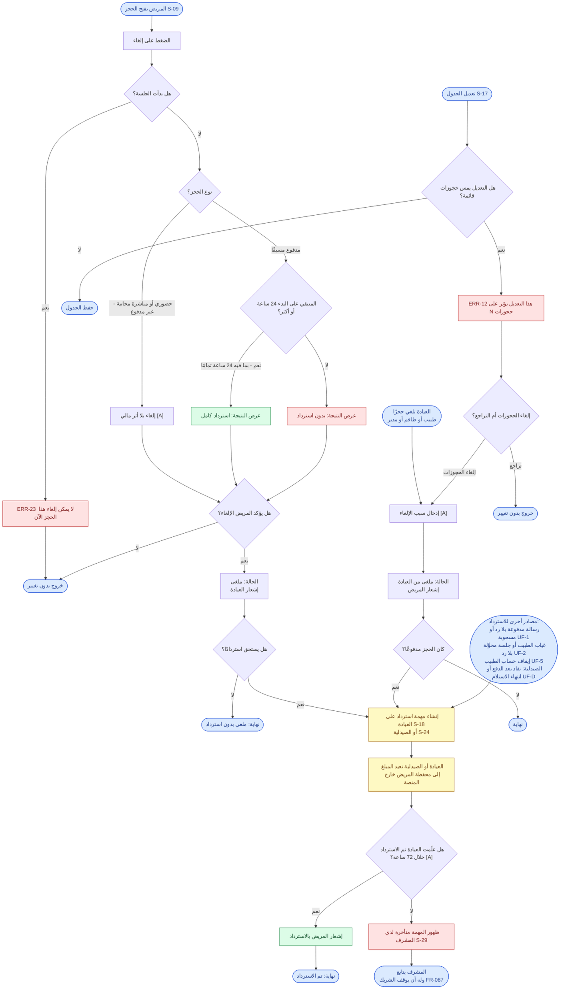

### الشرح

**إلغاء المريض:**
1. يفتح المريض الحجز ويضغط إلغاء. بعد بدء الجلسة لا يمكن الإلغاء (ERR-23).
2. الحجز **الحضوري**، أو الاستشارة المباشرة **المجانية**، يُلغى في أي وقت بلا أثر مالي لأنه غير مدفوع مسبقًا (BR-094 [A]، BR-056).
3. الحجز **المدفوع**: قبل 24 ساعة أو أكثر ← **استرداد كامل** (BR-090)؛ أقل من 24 ساعة ← **بدون استرداد** (BR-091). الإلغاء عند 24 ساعة تمامًا يُحسب استردادًا (EC-35 [A]).
4. **تُعرض النتيجة قبل التأكيد** (FR-084، AC-48، AC-49).

**إلغاء العيادة:**
5. العيادة تلغي مع ذكر السبب (FR-085 [A]) ← **استرداد كامل دائمًا** للحجز المدفوع (BR-092، AC-50).
6. حذف أوقات من الجدول عليها حجوزات يتطلب إلغاءها، ويُعتبر إلغاءً من العيادة (BR-068 [A]، ERR-12).

**تنفيذ الاسترداد:**
7. تُنشأ **مهمة استرداد** على العيادة (FR-086). إضافة إلى الإلغاء، تأتي مهام الاسترداد من: رسالة مدفوعة بلا رد (BR-043)، أو رسالة مدفوعة مسحوبة (BR-049)، أو غياب الطبيب (BR-054)، أو جلسة محوَّلة بلا رد (BR-057)، أو إيقاف حساب الطبيب (FR-009). وتُنشأ مهام على الصيدلية عند نفاد الدواء بعد الدفع (BR-135) أو انتهاء نافذة الاستلام (BR-099). العيادة أو الصيدلية تُعيد المبلغ مباشرة إلى محفظة المريض ثم تُعلّم "تم الاسترداد"، ويُشعَر المريض (BR-093).
8. المهام المتأخرة أكثر من 72 ساعة تظهر للمشرف (FR-087 [A]، EC-36). يتابع المشرف مع الشريك، وله أن يوقفه إذا بقي لا يعيد المبلغ (FR-087، FR-098).

### متطلبات PRD المرتبطة
US-08، BR-068، BR-090 – BR-094، BR-043، BR-049، BR-054، BR-057، FR-009، FR-084 – FR-087، AC-48 – AC-50، EC-35، EC-36، ERR-12، ERR-23.

### أسئلة مفتوحة
- حُسم في PRD v1.2: السؤال Q-08 (المشرف يتابع وله أن يوقف، FR-087؛ نزاعات الدفع تُحل بين الطرفين، BR-079).
- مهلة 72 ساعة للتأخير (FR-087) افتراض.

---

## UF-5 — تسجيل العيادة والأطباء والاشتراك

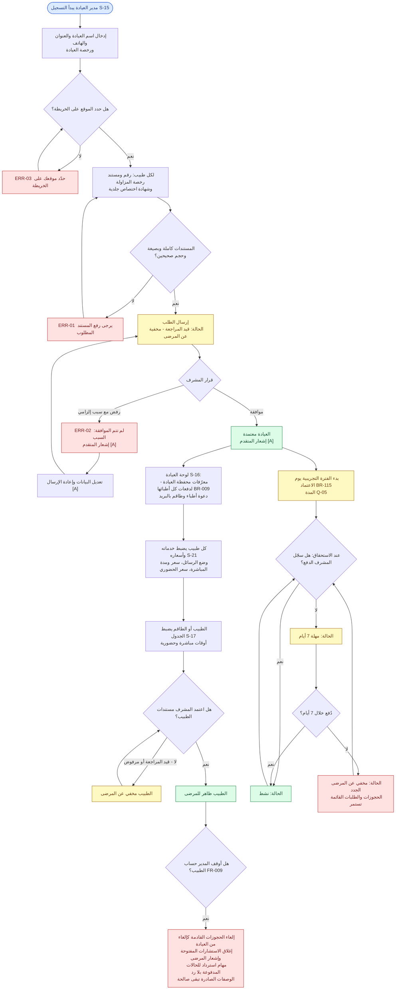

### الشرح

1. يسجّل **مدير العيادة** العيادة ذاتيًا: الاسم والعنوان والخريطة والهاتف ورخصة العيادة، ولكل طبيب رخصة مزاولة وشهادة اختصاص جلدية (BR-003، FR-001، FR-002). رقم رخصة المزاولة فريد، فلا ينضم الطبيب نفسه لعيادتين (BR-006، EC-02). لا يُسمح بطبيب بلا عيادة فعلية (BR-001)، والعيادة الخاصة = عيادة بطبيب واحد (BR-002)، ويمكن لمديرها أن يكون هو الطبيب (BR-008).
2. نقص مستند يمنع الإرسال (ERR-01، AC-01)، وكذلك عدم تحديد الموقع (ERR-03، AC-05).
3. بعد الإرسال تصبح الحالة **قيد المراجعة** والعيادة **مخفية** (BR-004، FR-003، AC-02).
4. **المشرف** يوافق أو يرفض مع **سبب إلزامي** (FR-004، AC-03). المرفوض يعدّل ويعيد الإرسال (BR-007 [A]).
5. بعد الموافقة: يضبط المدير معرّفات محفظة العيادة، وإليها تذهب دفعات كل أطبائها (BR-009)، ويدعو الأطباء والطاقم بالبريد (FR-007)، ويضبط كل طبيب خدماته وأسعاره، ويُضبط الجدول من الطبيب أو الطاقم (BR-065، FR-043).
6. **كل طبيب** يبقى مخفيًا حتى يعتمد المشرف مستنداته (BR-005، FR-008، AC-04). العيادة بلا أطباء ظاهرين لا تُعرض (EC-01 [A]).
   - **إيقاف حساب طبيب:** تُلغى حجوزاته القادمة كإلغاء من العيادة، وتُغلق استشاراته المفتوحة ويُشعَر المرضى، وتُنشأ مهام استرداد للحالات المدفوعة بلا رد، وتبقى الوصفات الصادرة صالحة. نقل الحالات إلى طبيب آخر خارج نطاق النسخة الأولى (FR-009، EC-42، AC-05a).
7. **الاشتراك:** واحد لكل عيادة لا لكل طبيب. فترة تجريبية تبدأ يوم اعتماد المشرف للعيادة، ثم اشتراك شهري (BR-111، BR-115). عند عدم الدفع في موعد الاستحقاق تبدأ **مهلة 7 أيام**، ثم **يُخفى الشريك عن المرضى الجدد** مع استمرار الحجوزات القائمة (BR-113، FR-093، FR-094، AC-52، AC-53). الدفع يسجّله المشرف يدويًا (BR-114).

### متطلبات PRD المرتبطة
US-15، US-17، US-22، US-24، BR-001 – BR-008، BR-065 – BR-068، BR-110 – BR-114، FR-001 – FR-009، FR-043 – FR-046، FR-091 – FR-094، AC-01 – AC-05، AC-05a، AC-24، AC-25، AC-52، AC-53، EC-01 – EC-04، EC-38، EC-42، ERR-01 – ERR-03.

### أسئلة مفتوحة
- **Q-05 / Q-06:** مدة الفترة التجريبية وأسعار الاشتراك. (حُسم Q-02 في PRD v1.2: تبدأ التجربة يوم الاعتماد، BR-115.)
- **EC-04:** تغيير عنوان العيادة يتطلب إعادة مراجعة مع إبقائها ظاهرة — افتراض لم يُرسم كمسار منفصل.
- لا يحدد PRD هل يمكن إعادة إظهار شريك "مخفي" فور الدفع (المخطط يعيده لدورة الاستحقاق فقط).

---

## UF-6 — تسجيل الصيدلية وتشغيلها اليومي

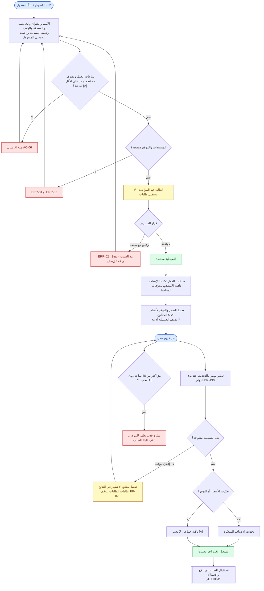

### الشرح

1. **التسجيل** بنفس طريقة العيادات: تسجيل ذاتي، رفع مستندات، اعتماد المشرف (BR-010، FR-012). المستندات المطلوبة مشتقة من "نفس العيادات" (BR-011 [A]). وتختار الصيدلية منطقتها من القائمة المحددة (BR-120، FR-010)، وتعمل من حساب واحد مشترك (BR-014).
2. ساعات العمل ومعرّف محفظة واحد على الأقل إلزاميان (BR-012، BR-013، FR-011 [A]، AC-06)، لأن ساعات العمل تُستخدم في قاعدة الـ30 دقيقة وفي إخفاء الصيدليات المغلقة.
3. بعد الاعتماد تضبط الصيدلية نافذة الاستلام (BR-097) والسعر والتوفر **لأصناف الكتالوج فقط** (BR-089، FR-071).
4. **يوميًا:** يرسل النظام تذكيرًا عند بدء الدوام، وتحدّث الصيدلية الأسعار والتوفر (BR-130)، مع شاشة تأكيد سريع "لا تغيير" (FR-072 [A]). كل تحديث يُسجَّل وقته ويُعرض (FR-073).
5. يمكن تفعيل **مغلق مؤقتًا** (مثلًا أثناء انقطاع الكهرباء) فتختفي من النتائج (FR-013 [A]، EC-05، AC-07)، وتتوقف عدّادات الطلبات أثناء الإغلاق (FR-075، EC-39، AC-41a).
6. عدم التحديث لأكثر من 48 ساعة يُظهر شارة "قديم" (BR-134 [A]).
7. الاشتراك يتبع نفس دورة العيادة في UF-5.

### متطلبات PRD المرتبطة
US-18، US-19، US-22، BR-010 – BR-013، BR-089، BR-097، BR-130، BR-134، FR-010 – FR-013، FR-071 – FR-073، FR-075، AC-06، AC-07، AC-41a، EC-05، EC-39، ERR-01 – ERR-03.

### أسئلة مفتوحة
- **Q-05 / Q-06:** مدة الفترة التجريبية والأسعار.
- حُسم في PRD v1.2: Q-16 (حساب واحد مشترك، BR-014) وQ-02 (التجربة تبدأ يوم الاعتماد، BR-115).
- قائمة المستندات المطلوبة (BR-011) وإلزامية ساعات العمل والمحفظة (FR-011) افتراضات.

---

## UF-7 — لوحة المشرف والبلاغات

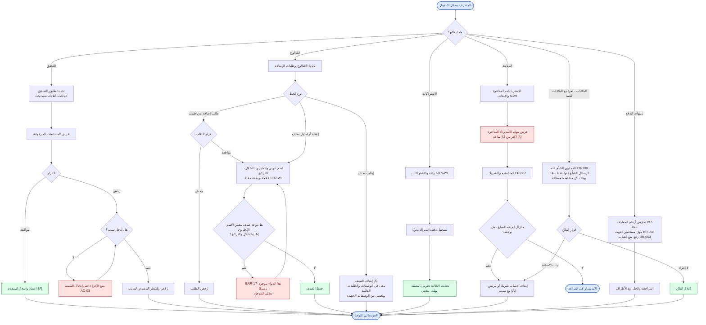

### الشرح

1. **طابور التحقق:** يراجع المشرف مستندات العيادات والأطباء والصيدليات، ويوافق أو يرفض؛ **الرفض يتطلب سببًا** (FR-004، FR-095، AC-03).
2. **الكتالوج:** المشرف وحده ينشئ ويعدّل ويوقف الأصناف (BR-087، FR-060)، وكل صنف له اسم عربي وإنجليزي (BR-088) وعلامة "بوصفة فقط" (BR-128). يعالج طلبات الإضافة القادمة من الأطباء (FR-061). التكرار ممنوع (FR-062 [A]، ERR-17). الصنف الموقوف يبقى في الوصفات والطلبات القائمة (FR-063 [A]، EC-24).
3. **الاشتراكات:** يسجّل المشرف الدفعات يدويًا ويتابع الحالات (BR-114، FR-091، FR-092).
4. **المتابعة:** يرى مهام الاسترداد المتأخرة (FR-087 [A])، ويتابع مع الشريك، وله أن يوقفه إذا بقي لا يعيد المبلغ (FR-087، FR-098).
5. **تنبيهات الدفع:** يراجع المشرف تعارض أرقام العمليات التي أبلغ عنها المرضى (BR-075)، والحالات التي انتهت فيها مهلة المستلم دون قرار (BR-078)، ويستطيع رفع منع الغياب (BR-063).
6. **البلاغات:** لا يصل المشرف إلى المحتوى الطبي بشكل عام (FR-099). **مراجع البلاغات** يرى الرسائل المُبلَّغ عنها فقط لمدة 14 يومًا، وكل مشاهدة تُسجَّل (FR-100، SEC-13، AC-53a). ثبوت الإساءة قد يؤدي إلى إيقاف الحساب.

### متطلبات PRD المرتبطة
US-22 – US-24، BR-004، BR-005، BR-063، BR-075، BR-078، BR-087، BR-088، BR-113، BR-114، BR-128، FR-004، FR-060 – FR-063، FR-087، FR-091 – FR-100، AC-03، AC-33، AC-34، AC-52، AC-53a، EC-24، ERR-17، SEC-13.

### أسئلة مفتوحة
- حُسم في PRD v1.2: Q-08 (المتابعة وإمكانية الإيقاف، FR-087؛ المنصة لا تتدخل في نزاعات الدفع، BR-079). كل المشرفين لهم نفس الصلاحيات ما عدا مراجع البلاغات (§15).
- **Q-10:** الوصول إلى المحتوى المُبلَّغ عنه فقط (FR-100) يحتاج تأكيدًا قانونيًا.
- **Q-20:** من يُعِدّ الكتالوج الأولي وقائمة المناطق؟
- صلاحية الإيقاف (FR-098) وإشعار المتقدم بالقرار (FR-005) افتراضات.

---

## ملخّص الأسئلة المفتوحة المؤثّرة على التدفقات

| السؤال | التدفقات المتأثرة | الأثر على التصميم |
|---|---|---|
| Q-10 وصول المشرف للمحتوى المُبلَّغ عنه (قانوني) | UF-0، UF-7 | شاشات البلاغات مرسومة؛ تُحذف إن لم يُسمح بها |
| Q-12 توقيت التذكيرات | UF-2، UF-3 | جدولة الإشعارات |
| Q-18 أقل مهلة للحجز | UF-2، UF-3 | إخفاء المواعيد القريبة جدًا |
| Q-14 / Q-19 التحقق القانوني من صلاحية 30 يومًا ومنع إعادة الصرف ومعاملة الأدوية بوصفة فقط | UF-C، UF-D | حالة انتهاء الصلاحية وخطوة تسجيل اسم المستلم |
| Q-05 / Q-06 الاشتراك | UF-5، UF-6 | مدة الفترة التجريبية والأسعار |

**حُسم في PRD v1.1:** السؤال Q-03 (مهل الدفع، BR-076 وBR-078) والسؤال Q-15 (يمكن للمدير أن يكون طبيبًا، BR-008). كلاهما مرسوم في التدفقات أعلاه.

**حُسم في PRD v1.2:** Q-02 (التجربة تبدأ يوم الاعتماد، BR-115)، وQ-04 (استرداد الطلب المنتهي، BR-099)، وQ-07 (المباشرة مجانية أو مدفوعة، BR-056)، وQ-08 (متابعة المشرف، FR-087؛ النزاعات بين الطرفين، BR-079)، وQ-09 (استرداد النفاد، BR-135)، وQ-16 (حساب صيدلية واحد، BR-014). كلها مرسومة في التدفقات أعلاه.
