# User Flows — Iltiam (التِئام)

| Field | Value |
|---|---|
| Source | [PRD.md](PRD.md) — Draft v1.2 (2026-10-27) |
| Date | 2026-10-22 · updated 2026-10-27 for PRD v1.1 and v1.2 |
| Scope | Confirmed MVP journeys only (PRD §9.1 and §13) |
| Format | Mermaid `flowchart TD` |
| Arabic version | [user-flow.ar.md](user-flow.ar.md) |

## How to read this document

- Each diagram covers one journey and is followed by an **explanation**, the **related PRD requirements**, and its own **open questions**.
- No business rule was added beyond the PRD. Steps based on a PRD **assumption [A]** are tagged `[A]` in the diagram, and steps that depend on an **open question** carry its number (e.g. `Q-04`).
- Screen (`S-xx`), error (`ERR-xx`), and edge-case (`EC-xx`) IDs are taken from the PRD as-is.
- Rules added in PRD v1.1 (delegated by the owner, tagged **[D]** in the PRD) are drawn like confirmed rules; their IDs are cited so they can be traced (e.g. `BR-048`).
- Rules added in PRD v1.2 come from the owner's answers to open questions (tagged **[C]** in the PRD) and are drawn as confirmed rules (e.g. `BR-135`).

### Legend

| Shape / colour | Meaning |
|---|---|
| `([ ... ])` blue | Entry or exit point |
| `[ ... ]` | User action or system response |
| `{ ... }` | Decision point |
| `[[ ... ]]` | Shared sub-flow (drawn in its own diagram) |
| Green | Success path |
| Red | Error state or failure path |
| Yellow | Waiting / pending state |

### Flow index

| # | Flow | Roles | PRD features |
|---|---|---|---|
| UF-0 | Role-based navigation | All | §14, §15 |
| UF-A | Sign-up, login & family members | Guest, Patient | F-03, F-04 |
| UF-1 | Async message consultation | Patient, Doctor | F-05 |
| UF-2 | Booked live text consultation (Should Have) | Patient, Doctor | F-06 |
| UF-3 | In-person appointment | Patient, Doctor, Clinic Staff | F-07 |
| UF-B | Manual payment verification (sub-flow) | Patient, Doctor/Staff, Pharmacy | F-09 |
| UF-C | Issuing an e-prescription | Doctor | F-10, F-11 |
| UF-D | Saydaliyati: order & pickup | Patient, Pharmacy | F-12, F-13, F-14 |
| UF-4 | Cancellation & refund | Patient, Clinic, Admin | F-15, F-08 |
| UF-5 | Clinic & doctor onboarding, subscription | Clinic Manager, Doctor, Staff, Admin | F-01, F-08, F-17 |
| UF-6 | Pharmacy onboarding & daily operations | Pharmacy, Admin | F-02, F-13 |
| UF-7 | Admin console & reports | Platform Admin | F-11, F-17, F-18 |

---

## UF-0 — Role-based navigation

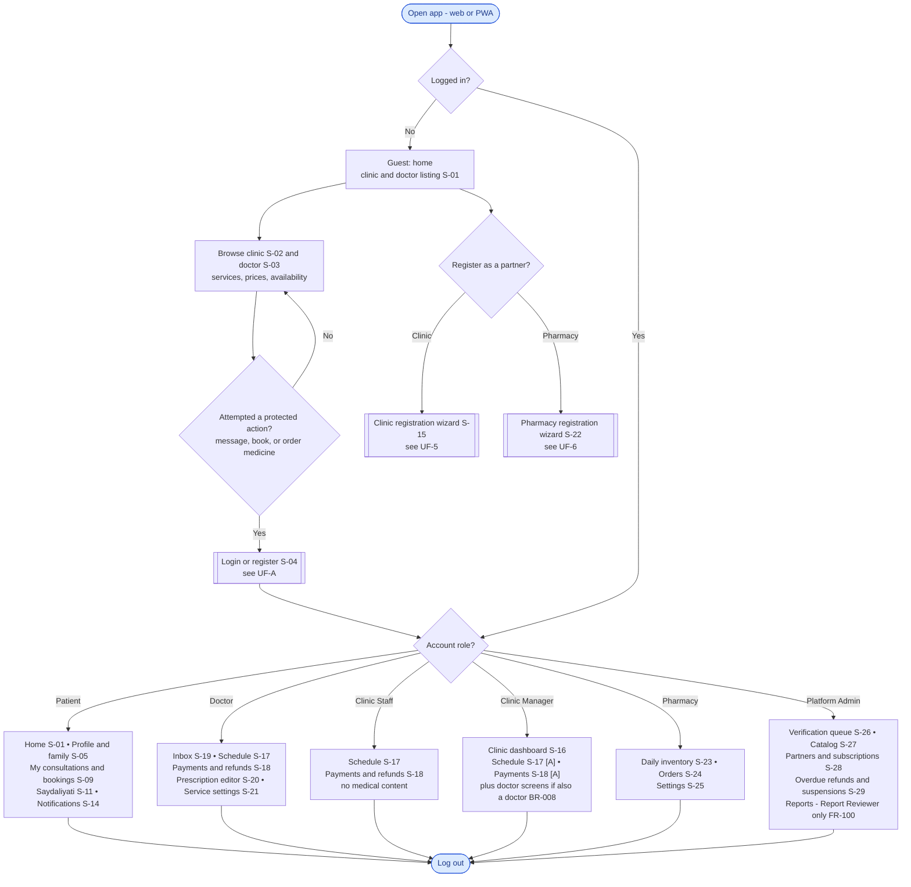

### Explanation

- A **guest** browses approved clinics, doctors, services, and prices without an account (BR-020). On any protected action they are asked to log in or register, then returned to the same action (FR-023).
- A guest can also start **partner registration** (clinic or pharmacy) through the dedicated wizard.
- After login, each user lands on the screens their role allows, per the permissions matrix (§15):
  - **Clinic Staff** see the schedule and payments only, **never medical content** (SEC-03, FR-031).
  - The **Admin** has no general access to medical content (FR-099). The only exception is a **Report Reviewer**, who sees reported messages only (FR-100).
  - **Clinic Manager** access to the schedule and payment confirmation is an assumption [A]. A manager who is also a doctor gets the doctor screens too, and reads medical content only through the Doctor role (BR-008).
- Notifications (S-14) are available to all logged-in roles.

### Related PRD requirements
BR-008, BR-020, FR-020, FR-023, §14 (S-01 – S-29), §15, SEC-01, SEC-03, FR-031, FR-099, FR-100.

### Open questions
- **Q-10:** Report-only Admin access (FR-100) still needs legal confirmation.
- Resolved in PRD v1.1: Q-15 (a Clinic Manager may also be a doctor, BR-008).
- Resolved in PRD v1.2: Q-16 (one shared pharmacy account, BR-014). All Admins share the same permissions except Report Reviewer (§15).

---

## UF-A — Sign-up, login & family members

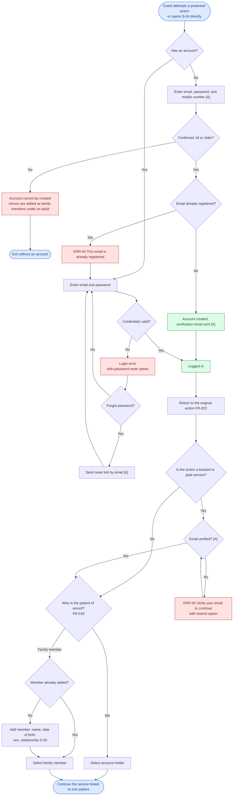

### Explanation

1. The guest reaches this flow when trying to message a doctor, book, or order medicine, or by opening the login screen directly.
2. **Registration** is by email and password only (BR-021). The account holder must confirm they are **18+**, or the account cannot be created (AC-10). A minor cannot use the platform alone and is added as a family member (EC-06).
3. If the email is already registered, ERR-04 is shown and the user is sent to login or password reset.
4. After login the user is **returned to the action they started** (FR-023, AC-08).
5. Email verification is required before the first paid or booked service (BR-024 — assumption [A]).
6. Every consultation, booking, and order requires selecting the **patient of record** — the account holder or a family member (BR-023, FR-018, AC-09). A new member can be added mid-flow. Removing a member archives it: it disappears from this selector, and its history is kept (FR-017, EC-46).

### Related PRD requirements
US-02, US-03, BR-020 – BR-025, FR-014 – FR-019, FR-023, AC-08 – AC-10, EC-06, EC-07, EC-46, ERR-04, ERR-05.

### Open questions
- Email verification before the first service (BR-024) and collecting a phone number (BR-025) are assumptions to validate (§26.3).
- The PRD only states "login rate-limited" (SEC-07); the lockout message and timing are undefined.

---

## UF-1 — Async message consultation

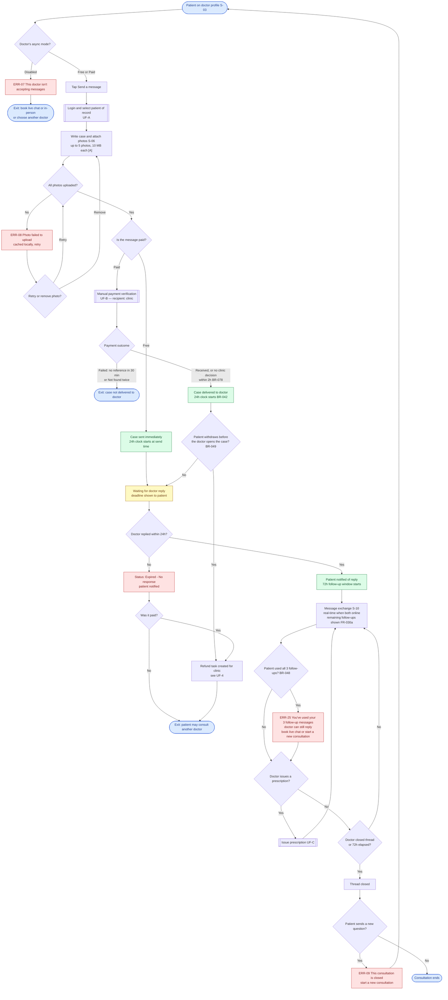

### Explanation

1. **Entry:** the doctor profile. The doctor sets async mode to Free (default), Paid (own price), or Disabled (BR-040). If disabled, the patient is offered live chat, in-person, or another doctor (ERR-07).
2. The patient logs in (or registers), selects the **patient of record**, writes the case, and attaches photos (BR-046). Photo limits are an assumption [A] (BR-047). A failed upload is cached and retried; the message isn't sent until all photos upload or the failed one is removed (EC-12).
3. A **free message** is sent immediately and the 24h clock starts. A **paid message** goes through manual payment (UF-B) first. The clock starts when the clinic confirms payment, or automatically if the clinic makes no decision within 2 hours (BR-042, BR-076, BR-078).
   - Until the doctor opens a paid case, the patient may **withdraw** it with a full refund (BR-049, FR-030b).
4. **No reply within 24h:** status becomes "Expired – No response", the patient is notified and may consult another doctor; if paid, a refund task is created for the clinic (BR-043, FR-029).
5. **After the first reply:** the thread stays open 72h for follow-ups; the doctor may close it earlier (BR-044). Messages are real-time when both are online (BR-045). The patient may send up to **3 follow-up messages**; the remaining count is shown, and at zero ERR-25 offers a paid live chat or a new consultation. The doctor's replies are not limited (BR-048, FR-030a, EC-47).
6. The doctor may issue a prescription during the consultation (UF-C).
7. After closure, input is disabled and the patient is prompted to start a new consultation (EC-11, ERR-09).
8. **Privacy:** case text and photos are visible only to the patient and the treating doctor — not Clinic Staff, not the Admin (FR-031, SEC-01).
9. **Reports:** the patient or the doctor can report a message. Only the reported messages are shared with a Report Reviewer, for 14 days, and every view is logged (FR-100, SEC-13). See UF-7.

### Related PRD requirements
US-04, US-12, BR-040 – BR-049, BR-076, BR-078, FR-024 – FR-031, FR-030a, FR-030b, FR-100, AC-12 – AC-17, AC-16a, AC-17a, AC-29a, EC-09 – EC-12, EC-47, ERR-07 – ERR-09, ERR-25, SEC-01, SEC-05, SEC-13, NFR-004, NFR-006.

### Open questions
- The follow-up limit of 3 (BR-048) and the 2-hour clinic window (BR-076) are delegated rules [D] to validate in the pilot.
- **EC-10:** The 24h SLA covers only the first reply; follow-ups are best-effort. Should the patient see any expected response time after the first reply? (Not defined in the PRD.)

---

## UF-2 — Booked live text consultation

> **Should Have (PRD QR-17).** Built after the core journey, and the first feature to cut if the timeline slips. Async messages already arrive in real time, within the follow-up limit of BR-048.

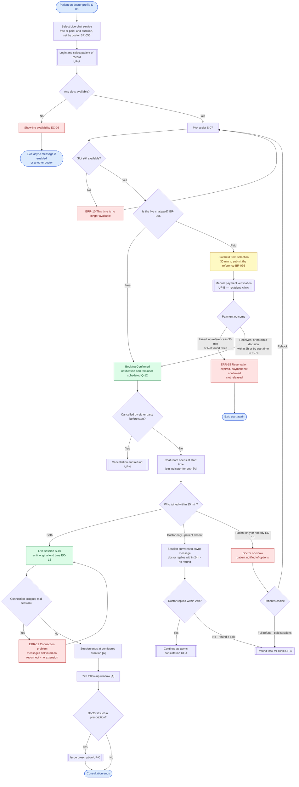

### Explanation

1. The patient selects the doctor, then **Live chat**. The doctor decides whether it is free or paid, and sets the duration (BR-051, BR-056, FR-032).
2. If there are no slots, "No availability" is shown; async messaging remains available if enabled (EC-08).
3. A picked slot is held **from the moment it is selected** (FR-033). If another patient got there first, ERR-10 is shown (EC-21).
4. A **free** session is confirmed as soon as the slot is picked (BR-052). A **paid** session is paid **in advance to the clinic's wallet**, and the booking is confirmed after the clinic confirms payment (BR-050, BR-052). The patient has **30 minutes** to submit the reference, or the slot is released (ERR-15). If the clinic makes no decision within **2 hours**, or by the session start, the booking is confirmed anyway and flagged to the Admin (BR-076, BR-078).
5. **At start time:**
   - **Patient absent after 15 min:** the session converts to an async message; the doctor replies within 24h, **no refund** (BR-053). If the doctor then doesn't reply within 24h, the patient of a paid session gets a **full refund** (BR-057, EC-41).
   - **Doctor absent after 15 min:** the patient chooses **Rebook** or, for a paid session, **Full refund** (BR-054). Both absent is treated as a doctor no-show (EC-13 [A]).
   - **Doctor late but within 15 min:** the session runs to the original end time (EC-15 [A]).
6. A dropped connection doesn't end the chat; it continues asynchronously with no extension (EC-14, ERR-11).
7. After the duration ends, the 72h follow-up window applies and a prescription may be issued.

### Related PRD requirements
US-05, BR-050 – BR-057, BR-076, BR-078, FR-032 – FR-038, FR-090, AC-18 – AC-21, AC-19a, AC-29b, EC-13 – EC-15, EC-21, EC-41, ERR-10, ERR-11, ERR-15.

### Open questions
- Resolved in PRD v1.2: Q-07 (the doctor chooses free or paid, BR-056).
- **Q-12:** Booking reminder timing.
- **Q-18:** Minimum notice before a slot can be booked.

---

## UF-3 — In-person appointment

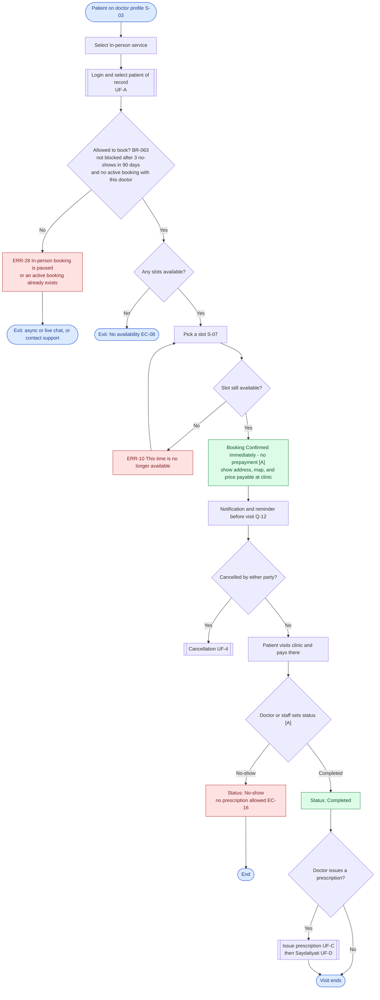

### Explanation

1. The patient selects the doctor, then **In-person**, then a slot. No payment goes through the platform; the patient pays at the clinic (BR-060).
   - Because nothing is prepaid, abuse is limited: one active in-person booking per patient of record per doctor, and an account with **3 no-shows in 90 days** cannot book in-person visits for 30 days. The Admin can lift the block (BR-063, ERR-28, AC-23a).
2. The booking is confirmed on slot selection (BR-061 [A]), and the clinic address, map pin, and payable price are shown (FR-040).
3. After the visit, the doctor or staff marks it **Completed** or **No-show** (BR-062 [A], FR-041).
4. **Prescriptions are only possible for Completed visits** (FR-042); none for a no-show (EC-16).
5. After a prescription, the patient continues in Saydaliyati (PRD UF-1 steps 8–13 = UF-D here).

### Related PRD requirements
US-06, BR-060 – BR-063, FR-039 – FR-042, AC-22, AC-23, AC-23a, EC-16, ERR-10, ERR-28.

### Open questions
- **Q-12:** Reminder timing.
- **Q-18:** Minimum booking notice.
- The no-show thresholds of BR-063 (3 in 90 days, 30-day block) are delegated rules [D] to validate in the pilot.

---

## UF-B — Manual payment verification (shared sub-flow)

Called from: paid async message (UF-1), live chat (UF-2), pharmacy order (UF-D).

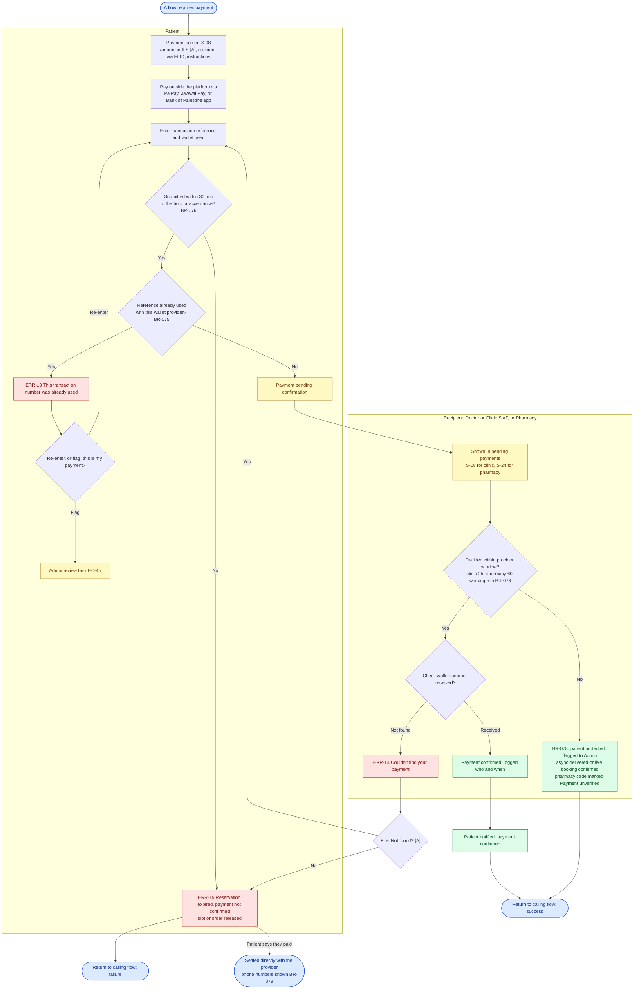

### Explanation

1. **The platform never receives funds**; payment goes directly from the patient's wallet to the clinic's or pharmacy's wallet (BR-070).
2. The platform shows the amount, recipient wallet ID, and instructions (FR-047). The patient pays in the wallet app, then enters the **transaction reference** and wallet used (BR-072, FR-048). **Receipt images are not used** (BR-074).
3. **Patient window:** the reference must be submitted within **30 minutes** of the slot hold or the pharmacy's acceptance, or the hold is released (BR-076, ERR-15, AC-29b).
4. A reference can be used only once **per wallet provider** (BR-075, ERR-13, AC-27). If the patient believes the number is theirs, they flag "this is my payment" and the Admin reviews it (EC-45).
5. The **recipient** (doctor or Clinic Staff for clinics; the pharmacy for orders) checks their wallet and marks **Received** or **Not found** (BR-073, FR-050).
6. On "Not found" the patient is notified and may **correct the reference once** before the hold is released (FR-051 [A]).
7. **Provider window:** the clinic must decide within **2 hours**, the pharmacy within **60 minutes of its working hours**. With no decision, the patient is protected and the case is flagged to the Admin: a paid async case is delivered, a live booking is confirmed, and a pharmacy order gets a pickup code marked "Payment unverified", so the pharmacy checks its wallet at the counter (BR-078, FR-052, EC-20, AC-29a).
8. Every confirmation is logged (who and when) (FR-053, NFR-011).
9. **Disputes:** if the patient says they paid but the provider can't find it, or the amount is wrong, the two settle it directly. The platform doesn't arbitrate; it shows each side the other's phone number (BR-079, EC-19).

### Related PRD requirements
US-07, US-16, BR-070 – BR-078, FR-047 – FR-053, FR-078, AC-26 – AC-29, AC-29a, AC-29b, EC-18 – EC-21, EC-45, ERR-13 – ERR-15, INT-1.

### Open questions
- The window lengths of BR-076 (30 min / 2 h / 60 min) are delegated rules [D] to validate in the pilot.
- Resolved in PRD v1.2: Q-08 (disputes are settled directly between the parties, BR-079).
- ILS currency (BR-077) and the single correction (FR-051) are assumptions.

---

## UF-C — Issuing an e-prescription (Doctor)

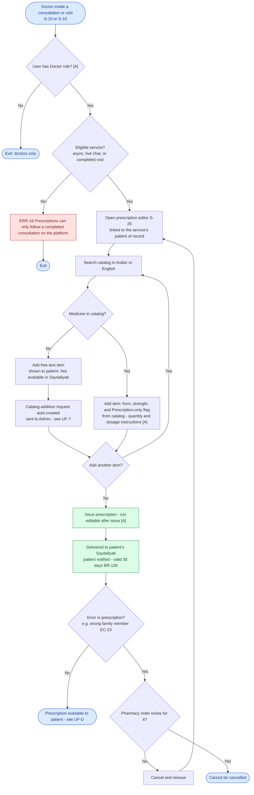

### Explanation

1. Only doctors can issue prescriptions (BR-083 [A]), and **only after a service performed on the platform**: an async message, a live chat, or a completed in-person visit (BR-080, ERR-16).
2. Items are selected from the **unified catalog**, searchable in Arabic or English (BR-081, FR-055).
3. If a medicine isn't in the catalog, the doctor adds a **free-text item** shown to the patient as "Not available in Saydaliyati", and a **catalog-addition request** is sent to the Admin automatically (BR-082, FR-056).
4. Once issued, the prescription reaches Saydaliyati and the patient is notified (FR-058). It is **valid for 30 days**, and each item can be dispensed **once** (BR-126, BR-127). Items flagged **Prescription-only** in the catalog need the collector's name at pickup (BR-128).
5. A prescription cannot be edited after issue; it can be cancelled and reissued **only if no pharmacy order exists** (BR-085 [A], FR-059, EC-23).

### Related PRD requirements
US-13, US-14, BR-080 – BR-089, BR-126 – BR-128, FR-054 – FR-063, AC-30 – AC-32, EC-22 – EC-24, ERR-16.

### Open questions
- **Q-19 / Q-14:** No refills and a 30-day validity (BR-126, BR-127), and the Prescription-only handling (BR-128), are proposed in PRD v1.1 and still need legal confirmation.
- Non-editability after issue (BR-085) is an assumption.

---

## UF-D — Saydaliyati: search, order, payment & pickup

```mermaid
flowchart TD
    START(["Prescription issued notification"]) --> LIST["Open Saydaliyati - prescriptions list S-11"]
    LIST --> VALIDP{"Prescription within 30 days? BR-126"}
    VALIDP -->|"No"| ERR27["ERR-27 This prescription has expired<br/>pending items marked Expired EC-43"]
    ERR27 --> ERR27X(["Exit: start a new consultation"])
    VALIDP -->|"Yes"| ONLYFT{"All items free-text?"}
    ONLYFT -->|"Yes"| FTX(["Show prescription, all items: Not available in Saydaliyati EC-22"])
    ONLYFT -->|"No"| GPS{"GPS allowed and successful?"}
    GPS -->|"No"| ERR19["ERR-19 Couldn't get your location<br/>choose area from list"]
    ERR19 --> RES
    GPS -->|"Yes"| RES["Pharmacy results S-12<br/>open and visible only - full availability first, then by distance<br/>price, last updated, outdated badge [A]"]
    RES --> ANY{"Any open pharmacy has any item?"}
    ANY -->|"No"| CLQ{"Matching pharmacies exist<br/>but all are closed now? FR-070"}
    CLQ -->|"Yes"| ERR26["ERR-26 Nearby pharmacies with these medicines are closed now<br/>the first opens at time EC-40"]
    ERR26 --> LATER
    CLQ -->|"No"| ERR18["ERR-18 No nearby pharmacy currently has these medicines"]
    ERR18 --> NOPH{"Change area or retry later?"}
    NOPH -->|"Change area"| ERR19
    NOPH -->|"Later"| LATER(["Exit: prescription stays pending"])
    ANY -->|"Yes"| FULL{"One pharmacy has all items?"}
    FULL -->|"Yes"| PICK["Pick one pharmacy<br/>pickup window shown before ordering"]
    FULL -->|"No"| HOW{"How does the patient proceed?"}
    HOW -->|"Split - Should Have"| SPLIT["Split order: one sub-order per pharmacy"]
    HOW -->|"Buy available"| SUB["Order available items<br/>rest stays Pending until the prescription expires"]
    PICK --> SEND["Send order"]
    SPLIT --> SEND
    SUB --> SEND

    SEND --> PHQ["Pharmacy receives order S-24<br/>items only, no diagnosis - countdown<br/>items locked while the order is active BR-127"]
    PHQ --> RESP{"Pharmacy response within 30 working minutes?<br/>paused while toggled Closed EC-39"}
    RESP -->|"No response"| ERR21["ERR-21 The pharmacy didn't respond in time<br/>auto-cancelled"]
    RESP -->|"Reject with reason [A]<br/>incl. partial stock - no partial accept"| ERR20["ERR-20 The pharmacy couldn't fulfil your order"]
    ERR21 --> BACKP["Items return to Pending<br/>other sub-orders continue EC-28"]
    ERR20 --> BACKP
    BACKP --> RES
    RESP -->|"Accept"| PRICE{"Patient accepts confirmed price? [A]"}
    PRICE -->|"No"| BACKP
    PRICE -->|"Yes"| PAY[["Manual payment verification<br/>UF-B — recipient: pharmacy"]]
    PAY --> PAYOK{"Payment confirmed?"}
    PAYOK -->|"No: no reference in 30 min<br/>or Not found twice"| RELEASE["Order released EC-32"]
    RELEASE --> BACKP
    PAYOK -->|"Received, or no pharmacy decision<br/>within 60 working min BR-078"| CODE["Pickup code issued: numeric and QR<br/>available offline S-13<br/>marked Payment unverified if not confirmed"]
    CODE --> SOUT{"Pharmacy finds a stock-out<br/>after payment? BR-135"}
    SOUT -->|"Yes"| SOREF["Order cancelled, full refund by pharmacy<br/>items return to Pending"]
    SOREF --> BACKP
    SOUT -->|"No"| REMIND["Daily reminder until pickup or expiry"]
    REMIND --> INWIN{"Someone with the code arrived within pickup window?"}
    INWIN -->|"No"| EXPIRED["Status: Expired<br/>pharmacy refunds in full BR-099"]
    EXPIRED --> EXPX(["End: order expired"])
    INWIN -->|"Yes"| VERIFY["Pharmacy enters or scans code"]
    VERIFY --> VALID{"Code valid for this pharmacy?"}
    VALID -->|"No"| ERR22["ERR-22 Code not valid for this pharmacy"]
    ERR22 --> VERIFY
    VALID -->|"Yes"| UNV{"Payment unverified?"}
    UNV -->|"Yes"| WCHK["Pharmacy checks its wallet at the counter BR-078"]
    UNV -->|"No"| RXO
    WCHK --> RXO{"Order has a Prescription-only item?"}
    RXO -->|"Yes"| NAME["Record collector's name<br/>and check patient of record BR-128"]
    RXO -->|"No"| DELIV
    NAME --> DELIV["Status: Delivered<br/>items dispensed, cannot be reordered BR-127"]
    DELIV --> DONE(["End: medicine in patient's or relative's hands"])

    classDef entry fill:#dbeafe,stroke:#1d4ed8,color:#1e3a8a
    classDef success fill:#dcfce7,stroke:#15803d,color:#14532d
    classDef error fill:#fee2e2,stroke:#b91c1c,color:#7f1d1d
    classDef pending fill:#fef9c3,stroke:#a16207,color:#713f12
    class START,FTX,LATER,EXPX,DONE,ERR27X entry
    class CODE,DELIV success
    class ERR18,ERR19,ERR20,ERR21,ERR22,ERR26,ERR27,EXPIRED,RELEASE error
    class PHQ,REMIND,BACKP,SOREF pending
```

### Explanation

1. A notification arrives and the patient opens **Saydaliyati**. A prescription is valid for **30 days**; after that its pending items cannot be ordered (BR-126, ERR-27, EC-43). Free-text items are never matched to pharmacies (BR-125); if all items are free-text, only the prescription is shown (EC-22).
2. **Location:** GPS first; if denied or failed, the patient picks an area from a list, and sees the pharmacies assigned to that area (BR-120, ERR-19, EC-25).
3. **Results:** only open, non-hidden pharmacies (BR-124), ranked with full-availability pharmacies first, then by distance (BR-121, FR-066), with price and "last updated" (BR-122), and an "outdated" badge after 48h (BR-134 [A], EC-27).
4. If no pharmacy has anything, ERR-18 is shown with options to change area or retry later. If matching pharmacies exist but are all closed (for example at night), ERR-26 shows the earliest opening time instead (FR-070, EC-40).
5. If no single pharmacy has everything, the patient can **buy what's available** and leave the rest pending until the prescription expires (BR-123, FR-068). **Splitting** across pharmacies in one step (FR-067) is Should Have; without it the patient reaches the same result by ordering subsets one after another. The pickup window is shown before ordering (FR-069). Each order draws from exactly one prescription (BR-129).
6. The **pharmacy** sees items only, no diagnosis (FR-077, SEC-02), and must accept or reject within **30 minutes of its working hours**, or the order auto-cancels (BR-131, FR-075, FR-076). Time while it is toggled Closed doesn't count (EC-39). Rejection includes a reason, including "partial stock"; partial acceptance isn't supported (BR-133). Items in an active order are locked (BR-127).
7. On rejection or auto-cancel, items return to Pending and the patient picks another pharmacy; other sub-orders continue (EC-28).
8. **Payment happens only after acceptance**, and the accepted price is the price to pay (BR-132). The patient may decline before paying if the price changed (EC-30 [A]).
9. The patient must submit the payment reference within **30 minutes** of acceptance, or the order is released (BR-076, EC-32). Once the pharmacy confirms payment, a **pickup code** (numeric + QR) is issued and viewable offline (BR-095, FR-079, FR-080). If the pharmacy makes no decision within 60 working minutes, the code is still issued but marked "Payment unverified" (BR-078). **Anyone holding the code can collect** (BR-096). A daily reminder runs until pickup or expiry (BR-098).
10. The pharmacy enters or scans the code; if it belongs to another pharmacy, ERR-22 is shown. For an unverified payment it checks its wallet first; for Prescription-only items it records the collector's name (BR-128, AC-47a). The order is then marked **Delivered**, and its items can't be ordered again (FR-081, BR-127).
11. If the pharmacy finds a **stock-out after payment**, it cancels the order and refunds in full; the items return to Pending so the patient can order them elsewhere (BR-135, BR-127, EC-31).
12. If the pickup window ends, the order becomes **Expired** (FR-083) and the pharmacy refunds the patient in full (BR-099, EC-34).

### Related PRD requirements
US-09 – US-11, US-19 – US-21, BR-076, BR-078, BR-095 – BR-099, BR-120 – BR-134, FR-064 – FR-083, AC-35 – AC-47, AC-39a – AC-39c, AC-41a, AC-47a, EC-22, EC-25 – EC-34, EC-39, EC-40, EC-43, EC-44, ERR-18 – ERR-22, ERR-26, ERR-27, SEC-02, SEC-10, NFR-005.

### Open questions
- Resolved in PRD v1.2: Q-04 (expired order: full refund, BR-099) and Q-09 (stock-out after payment: full refund, items back to Pending, BR-135).
- **Q-14 / Q-19:** The 30-day validity, single dispensing, and Prescription-only handling (BR-126 – BR-128) still need legal confirmation.
- "Notify me when available" is deferred to Phase 3, so it is not drawn under ERR-18.

---

## UF-4 — Cancellation & refund

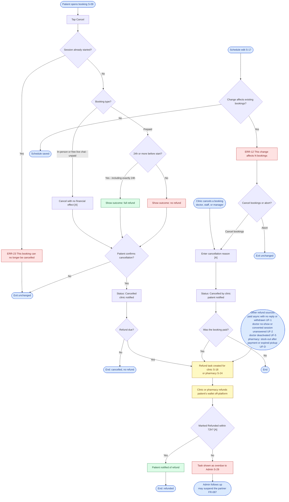

### Explanation

**Patient cancellation:**
1. The patient opens the booking and taps Cancel. After the session starts, cancellation is not possible (ERR-23).
2. An **in-person** booking, or a **free** live chat, can be cancelled any time with no financial effect, since nothing was prepaid (BR-094 [A], BR-056).
3. A **prepaid** booking: ≥ 24h before start → **full refund** (BR-090); < 24h → **no refund** (BR-091). Exactly 24h counts as refund (EC-35 [A]).
4. **The outcome is shown before confirming** (FR-084, AC-48, AC-49).

**Clinic cancellation:**
5. The clinic cancels with a reason (FR-085 [A]) → **always a full refund** for a paid booking (BR-092, AC-50).
6. Removing availability that has bookings requires cancelling them, which counts as a clinic cancellation (BR-068 [A], ERR-12).

**Refund execution:**
7. A **refund task** is created for the clinic (FR-086). Besides cancellations, refund tasks come from an unanswered paid message (BR-043), a withdrawn paid message (BR-049), a doctor no-show (BR-054), an unanswered converted live session (BR-057), and a doctor's deactivation (FR-009). Pharmacies get refund tasks for a stock-out after payment (BR-135) and an expired pickup (BR-099). The clinic or pharmacy refunds the patient's wallet directly, marks "Refunded", and the patient is notified (BR-093, FR-086).
8. Tasks overdue by more than 72h are shown to the Admin (FR-087 [A], EC-36). The Admin follows up with the partner and may suspend it if it still doesn't refund (FR-087, FR-098).

### Related PRD requirements
US-08, BR-068, BR-090 – BR-094, BR-043, BR-049, BR-054, BR-057, FR-009, FR-084 – FR-087, AC-48 – AC-50, EC-35, EC-36, ERR-12, ERR-23.

### Open questions
- Resolved in PRD v1.2: Q-08 (Admin follows up and may suspend, FR-087; payment disputes are settled between the parties, BR-079).
- The 72h overdue threshold (FR-087) is an assumption.

---

## UF-5 — Clinic & doctor onboarding, subscription

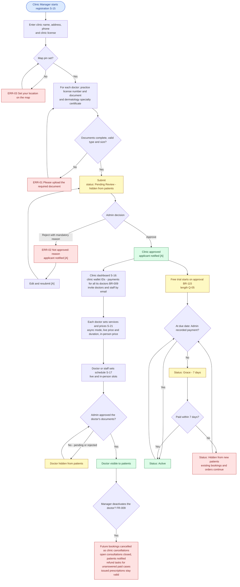

### Explanation

1. The **Clinic Manager** self-registers the clinic: name, address, map pin, phone, clinic license, and for each doctor a practice license and dermatology specialty certificate (BR-003, FR-001, FR-002). The practice license number is unique, so the same doctor can't join two clinics (BR-006, EC-02). No doctor without a physical clinic (BR-001); a private clinic is a one-doctor clinic (BR-002), and its manager may also hold the Doctor role (BR-008).
2. A missing document blocks submission (ERR-01, AC-01), as does a missing map pin (ERR-03, AC-05).
3. After submission the status is **Pending Review** and the clinic is **hidden** (BR-004, FR-003, AC-02).
4. The **Admin** approves or rejects with a **mandatory reason** (FR-004, AC-03). A rejected applicant edits and resubmits (BR-007 [A]).
5. After approval, the manager sets the clinic's wallet IDs, where patients pay for all of its doctors (BR-009), and invites doctors and staff by email (FR-007); each doctor configures services and prices; the schedule is set by the doctor or staff (BR-065, FR-043).
6. **Each doctor** stays hidden until the Admin approves their documents (BR-005, FR-008, AC-04). A clinic with zero visible doctors is not listed (EC-01 [A]).
   - **Deactivating a doctor:** future bookings are cancelled as clinic cancellations, open consultations are closed and the patients notified, unanswered paid cases get refund tasks, and issued prescriptions stay valid. Transfer to another doctor is out of scope (FR-009, EC-42, AC-05a).
7. **Subscription:** one per clinic, not per doctor. A free trial starts on the day the Admin approves the clinic, then monthly (BR-111, BR-115). If unpaid at the due date, a **7-day grace period** starts, after which the partner is **hidden from new patients** while existing bookings continue (BR-113, FR-093, FR-094, AC-52, AC-53). Payments are recorded manually by the Admin (BR-114).

### Related PRD requirements
US-15, US-17, US-22, US-24, BR-001 – BR-008, BR-065 – BR-068, BR-110 – BR-114, FR-001 – FR-009, FR-043 – FR-046, FR-091 – FR-094, AC-01 – AC-05, AC-05a, AC-24, AC-25, AC-52, AC-53, EC-01 – EC-04, EC-38, EC-42, ERR-01 – ERR-03.

### Open questions
- **Q-05 / Q-06:** Trial length and subscription prices. (Q-02 resolved in PRD v1.2: the trial starts on approval, BR-115.)
- **EC-04:** An address change requires re-review while the clinic stays visible — an assumption, not drawn as a separate path.
- The PRD doesn't say whether a Hidden partner becomes visible immediately on payment (the diagram simply returns it to the due-date cycle).

---

## UF-6 — Pharmacy onboarding & daily operations

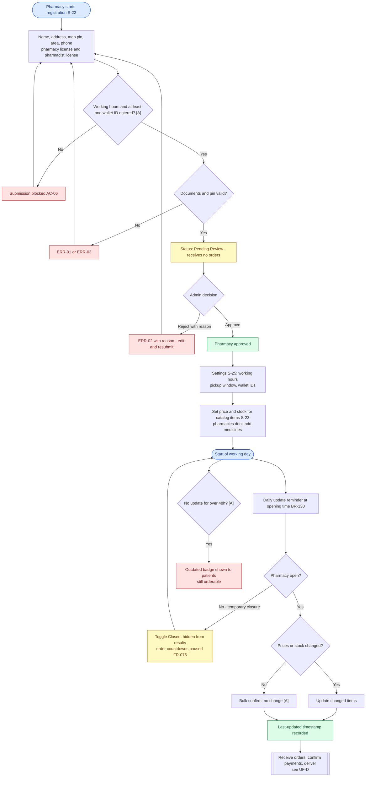

### Explanation

1. **Registration** works like clinics: self-registration, document upload, Admin approval (BR-010, FR-012). Required documents are derived from "same as clinics" (BR-011 [A]). The pharmacy also picks its area from the predefined list (BR-120, FR-010), and works from one shared account (BR-014).
2. Working hours and at least one wallet ID are mandatory (BR-012, BR-013, FR-011 [A], AC-06), since working hours drive the 30-minute rule and hiding closed pharmacies.
3. After approval the pharmacy sets its pickup window (BR-097) and price and stock **for catalog items only** (BR-089, FR-071).
4. **Daily:** the system sends an update reminder at opening time, and the pharmacy updates prices and stock (BR-130), with a quick "no change" confirm screen (FR-072 [A]). Every update is timestamped and shown (FR-073).
5. The pharmacy can toggle **Closed** temporarily (e.g. during a power cut) and disappears from results (FR-013 [A], EC-05, AC-07). Order countdowns pause while it is Closed (FR-075, EC-39, AC-41a).
6. No update for more than 48h shows an "outdated" badge (BR-134 [A]).
7. The subscription follows the same cycle as clinics in UF-5.

### Related PRD requirements
US-18, US-19, US-22, BR-010 – BR-013, BR-089, BR-097, BR-130, BR-134, FR-010 – FR-013, FR-071 – FR-073, FR-075, AC-06, AC-07, AC-41a, EC-05, EC-39, ERR-01 – ERR-03.

### Open questions
- **Q-05 / Q-06:** Trial length and prices.
- Resolved in PRD v1.2: Q-16 (one shared account, BR-014) and Q-02 (trial starts on approval, BR-115).
- The document list (BR-011) and mandatory working hours and wallet (FR-011) are assumptions.

---

## UF-7 — Admin console

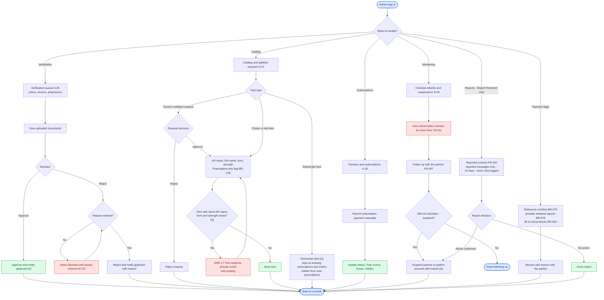

### Explanation

1. **Verification queue:** the Admin reviews documents of clinics, doctors, and pharmacies and approves or rejects; **rejection requires a reason** (FR-004, FR-095, AC-03).
2. **Catalog:** only the Admin creates, edits, and deactivates items (BR-087, FR-060); each item has an Arabic and an English name (BR-088) and a Prescription-only flag (BR-128). The Admin handles doctors' addition requests (FR-061). Duplicates are blocked (FR-062 [A], ERR-17). A deactivated item stays on existing prescriptions and orders (FR-063 [A], EC-24).
3. **Subscriptions:** the Admin records payments manually and tracks statuses (BR-114, FR-091, FR-092).
4. **Monitoring:** the Admin sees overdue refund tasks (FR-087 [A]), follows up with the partner, and may suspend it if it still doesn't refund (FR-087, FR-098).
5. **Payment flags:** the Admin reviews reference conflicts flagged by patients (BR-075), cases where a provider let its confirmation window lapse (BR-078), and can lift no-show blocks (BR-063).
6. **Reports:** the Admin has no general access to medical content (FR-099). A **Report Reviewer** sees only the reported messages, for 14 days, and every view is logged (FR-100, SEC-13, AC-53a). Confirmed abuse can lead to suspension.

### Related PRD requirements
US-22 – US-24, BR-004, BR-005, BR-063, BR-075, BR-078, BR-087, BR-088, BR-113, BR-114, BR-128, FR-004, FR-060 – FR-063, FR-087, FR-091 – FR-100, AC-03, AC-33, AC-34, AC-52, AC-53a, EC-24, ERR-17, SEC-13.

### Open questions
- Resolved in PRD v1.2: Q-08 (follow up and may suspend, FR-087; the platform doesn't arbitrate payment disputes, BR-079). All Admins share the same permissions except Report Reviewer (§15).
- **Q-10:** Report-only access (FR-100) still needs legal confirmation.
- **Q-20:** Who compiles the initial catalog and areas list?
- The suspension power (FR-098) and notifying the applicant of the decision (FR-005) are assumptions.

---

## Summary of open questions affecting the flows

| Question | Affected flows | Design impact |
|---|---|---|
| Q-10 Admin access to reported content (legal) | UF-0, UF-7 | Report screens drawn; remove if not allowed |
| Q-12 Reminder timing | UF-2, UF-3 | Notification scheduling |
| Q-18 Minimum booking notice | UF-2, UF-3 | Hiding near-term slots |
| Q-14 / Q-19 Legal check of 30-day validity, no refills, Prescription-only handling | UF-C, UF-D | Expiry state and collector-name step |
| Q-05 / Q-06 Subscription | UF-5, UF-6 | Trial length and prices |

**Resolved in PRD v1.1:** Q-03 (payment windows, BR-076 and BR-078) and Q-15 (manager may also be a doctor, BR-008). Both are drawn in the flows above.

**Resolved in PRD v1.2:** Q-02 (trial starts on approval, BR-115), Q-04 (expired order refunded, BR-099), Q-07 (live chat free or paid, BR-056), Q-08 (Admin follow-up, FR-087; disputes between the parties, BR-079), Q-09 (stock-out refund, BR-135), and Q-16 (one pharmacy account, BR-014). All are drawn in the flows above.
